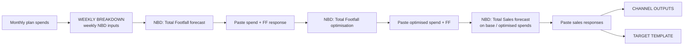

# NBD Forecast and Optimisation Template

**File:** [`NBD 2026 USE ME.xlsx`](https://interpublic.sharepoint.com/:f:/r/sites/TheBicesterCollection/Shared%20Documents/VR%20MMM/NBD%20Training?d=w0a3a7ed83d794a7fb718385a0a499846&csf=1&web=1&e=qdjIXE)  
**Role:** Bridge between a **monthly media plan** and **NBD** (Next Best Decision) footfall / sales forecasts and optimisations for Value Retail villages. You split plan spend into weekly NBD inputs, paste NBD export time series back into colour-coded tabs, and read base-vs-optimised results in the output sheets.

{: .important }
> Always **make a copy** of the template per village / scenario before pasting exports. Tabs are colour-coded so you paste spend vs response into the right place.

{: .note }
> This page covers the **Excel template workflow** around NBD runs, not the NBD2 platform UI itself.

---

## What the workbook does (in one pass)

1. Choose **village** and **year**, paste **monthly channel spends**.
2. The pink weekly grid turns months into **weekly spends** NBD can ingest.
3. Run NBD **footfall forecast** → paste exports → run **footfall optimisation** → paste again.
4. Run NBD **sales** forecast(s) on the same weekly spends → paste sales responses.
5. Read **CHANNEL OUTPUTS** (base vs optimised by channel) and **TARGET TEMPLATE** (monthly by audience: spend, footfall, CPV, ROI / revenue / POAS).

---

## Suggested run order (from `INSTRUCTIONS`)

The `INSTRUCTIONS` sheet is the source of truth for the operator sequence. Condensed:

| Step | Action |
|---|---|
| 1 | Enter the monthly plan so weekly media splits are ready for a **Total Footfall** forecast |
| 2 | In NBD, run a **Total Footfall forecast** using those weekly splits |
| 3 | Export from NBD → two sheets: **Optimised Spend Time Series** and **Predicted Response Time Series** |
| 4–5 | Paste channel names + spend (from row C) and footfall response into the forecast paste tabs |
| 8 | Run a **Total Footfall optimisation** in NBD using the forecast spends |
| 9–11 | Export again; paste optimised spend + footfall response into the optimisation paste tabs |
| 12–15 | Using base-plan weekly spends, run a **Total Sales** forecast in NBD; paste predicted sales response so **TARGET TEMPLATE** revenue populates |
| 16 | Read **CHANNEL OUTPUTS** and **TARGET TEMPLATE** |

{: .tip }
> Before every new NBD run, **select the channels in NBD**. The Instructions FAQ states this is required for all new runs. Export via the **Export** button on NBD's Export tab.

{: .note }
> Some Instruction step labels still name older paste-tab titles (e.g. "WEEKLY BREAKDOWNS FF 53 WEEKS", "OPTIMISED SPENDS"). In the current `USE ME` file the live input grid is **`WEEKLY BREAKDOWN SALES 52 Weeks`**, and results land in **`NBD Channel Outputs`**, **`Monthly Outputs Forecast(TT)`**, **`Monthly Outputs Optimised(TT)`**, then surface on **CHANNEL OUTPUTS** / **TARGET TEMPLATE**. Follow colour coding in the workbook if a tab name in Instructions looks stale.

---

## Sheet map

| Sheet | Purpose |
|---|---|
| **INSTRUCTIONS** | Run order + FAQ (export, channel selection, who to contact) |
| **Village Name + SC** | Village code (e.g. MV), Footfall/Sales share-code slots for the NBD scenario |
| **WEEKLY BREAKDOWN SALES 52 Weeks** | Main **input**: village + year selectors, monthly spend paste, weekly split table for NBD |
| **Template Calcs** | Calendar helpers (weeks in year, month lengths) and **media contribution %** by village used in target maths |
| **Channel Names** | Map of NBD input IDs (`SPEND_…_BV`) ↔ readable channel labels ↔ village |
| **Audience Look up** / **Audience Look up 2** | Parse channel keys into **Domestic / Destination / Source** (and related) audience tags |
| **SPV Lookup** | Sales-per-visitor (and related) rates by channel×village for revenue maths |
| **NBD Channel Outputs** | Aggregated **forecast vs optimised** spend / KPI / CpKPI / ROI by channel (feeds CHANNEL OUTPUTS) |
| **Monthly Outputs Forecast(TT)** | Month × channel forecast: spend, footfall, sales; SPV VLOOKUP → SPV revenue |
| **Monthly Outputs Optimised(TT)** | Same shape for the **optimised** plan |
| **CHANNEL OUTPUTS** | Presentation: base vs optimised spend, KPI, cost-per-KPI, and % diffs |
| **TARGET TEMPLATE** | Annual target vs estimated media-driven footfall; monthly Domestic / Destination / Source tables for forecast and optimised plans |
| **NBD Channel Unique List** / **Sheet5** / **OUTPUTS>>** | Supporting / navigation helpers |

---

## How the input tab works

On **`WEEKLY BREAKDOWN SALES 52 Weeks`** (labelled "NBD Template V4" in-sheet):

1. Select the **village** in the orange drop-down (drives village code used in channel keys).
2. Select the **year** in the blue cell (links to `Village Name + SC` / week count — 52 vs 53).
3. Use yellow drop-downs for channel / audience choices as needed.
4. Paste **monthly spends** by channel into the monthly columns.
5. The **pink weekly area** fills weekly spends for NBD (month totals ÷ weeks, with year-length logic from **Template Calcs**).

Channel keys follow the NBD naming pattern, e.g. `spend_META_DOMESTIC_BV`, and are aligned via **Channel Names** / audience lookups so Domestic vs Destination vs Source rollups work downstream.

---

## How outputs are calculated

### CHANNEL OUTPUTS

Pulls channel rows from **NBD Channel Outputs** and computes:

- Base: Spend, KPI (footfall), Cost per KPI  
- Optimised: Spend, KPI, Cost per KPI  
- Diffs: absolute and % change in spend and footfall  

Use this for **same-budget mix** comparisons (title text references "Optimisation – Same Budget").

### TARGET TEMPLATE

- Enter the **annual footfall target**.
- **Current plan** media-driven footfall comes from NBD forecast totals; **media contribution %** is looked up from **Template Calcs** by village.
- Estimated **total** footfall ≈ media-driven ÷ contribution % (rough; assumes contribution stays in line with the reference year).
- **Optimised plan** block uses the optimised media-driven total the same way.
- Monthly grids `SUMIFS` **Monthly Outputs Forecast(TT)** / **Optimised(TT)** by month and audience keyword (`*domestic*`, `*destination*`, `*source*`) for spend, footfall, CPV, ROI, revenue, profit, POAS.

**SPV path:** monthly footfall × **SPV Lookup** rate → SPV revenue on the monthly output sheets, which then feeds TARGET TEMPLATE revenue / POAS columns.

---

## Practical checklist

1. Copy `NBD 2026 USE ME.xlsx` → name it with village + scenario.  
2. Fill **Village Name + SC** (and store NBD share codes when you have them).  
3. Complete **WEEKLY BREAKDOWN** monthly spends → confirm weekly totals look sensible.  
4. In NBD: select channels → Footfall forecast → export → paste.  
5. Footfall optimisation → export → paste.  
6. Sales forecast(s) → paste responses.  
7. QA **CHANNEL OUTPUTS** and **TARGET TEMPLATE** (targets, contribution %, audience splits).  
8. Issues with the tool → Central team (per Instructions).

---

## Related

- [Value Retail → Dashboarding Phase](../value-retail/mmm-data-processing/dashboarding-phase/) — MLP → NBD-shaped files → Power BI (post-model pipeline, not this Excel template)
