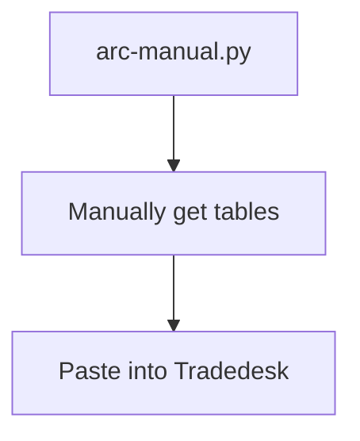

## ARC Manuel

With current API write issues, here we can show you how to manually upload a standard ARC attention bid list and allow list to the adgroup.

Use this notebook to export the bid list and the allow list:

[LINK](https://dbc-341b6afb-df67.cloud.databricks.com/editor/notebooks/3013872570025463?o=7058903129942627#command/6014209298075960)

Save both tables as xlsx tables.

For the Bidlist table, make sure the column names are Site / App ID & Bid Factor (2 decimal places). The bid list file should look something like this:

| Site / App ID        | Bid Factor |
|----------------------|------------|
| example.com          | 1.2        |
| mobile-app-123       | 1.9        |
| news-site.net        | 1.0        |
| video-streamer.app   | 1.5        |
| blog-platform.co     | 1.8        |

The allow list file should look something like this: 

| Site / App ID        |
|----------------------|
| example.com          |
| mobile-app-123       |
| news-site.net        |
| video-streamer.app   |
| blog-platform.co     |

Go to the ad groups you need to add the bid list and white list to and you need to click ADD RAIL under TARGETING in order to add the allow list. After that you need to click ADD RAIL under OPTIMIZATIONS TO add a bid list: 

