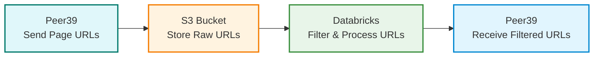

## ARC Contextual

Arc Contextual is when we target by a page url level for display campaigns. You can't directly plug page level url's into Tradedesk or Yahoo DSP. You have to do it through an affiliated third party like Peer39.

ARC repo currently only works on the DataOps Shared Compute Cluster.

## General ARC Contextual Process

## S3 Bucket

Currently the URLs go to this bucket here. When settting up a new campaign, it would be best to receive those files in a new folder in the bucket: 

[View S3 Bucket](https://us-east-1.console.aws.amazon.com/s3/buckets/p39-prod-feedout-mediahub)

## Databricks Notebook & Workflow

This is the notebook that runs ARC Contextual: 

[View Notebook](https://dbc-341b6afb-df67.cloud.databricks.com/editor/notebooks/1070495127561986?o=7058903129942627#command/6120987330216781)

There may be more then one workflow to run an ARC Contextual campaign. For example, currently for Kraken this is the workflow: 

[View Workflow](https://dbc-341b6afb-df67.cloud.databricks.com/jobs/1070042294661661?o=7058903129942627)

### Get URLs process

The get_urls.py script gets the urls from the S3 bucket, processes them and creates a tier list depending on how we want to segment and target with our data.

### Push URLs process

The push_urls.py script gets the urls from a processed table (for Kraken for example hive_metastore.kraken.bronze_contextual_arc_kraken_processed) and pushes them to the Peer39 Segments

## When setting up a new Peer39 campaign

You need to first create the segments in the Peer39 platform

With ARC Tradedesk campaigns we attach both a bidlist and a whitelist when running campaigns. Login details can be found in the bitwarden. The Seat ID/Advertiser ID comes from the DSP. You need to go to this [Peer39 site](https://app.peer39.com/manage) and set up a segment like so and copy the category ID:

The current Partner ID for a Tradedesk campaign is 1407. For a Yahoo DSP campaign it's 1423. 

Then create a new entry in the dictionary in the constants.py and add the category name, category ID and the tier to it: 

