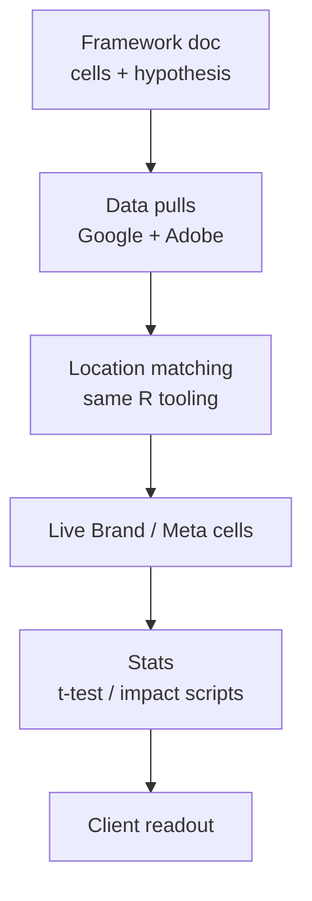

# Brand Search tests

Geo-holdout designs specifically about **Brand Paid Search** — either measuring its incrementality (on/off) or the impact of **moving Brand Search budget into Meta**.

Both use the same geo-holdout craft as [Geo-holdout testing](geo-holdout-testing) (matched regions, halo control, consistent other-media levels). Framework Word docs live in the SharePoint folders below.

---

## August 2024 — Brand Search → Meta

**Folder:** `…\Celebrity Cruises\Brand Search Test August 2024\`

| Artefact | Role |
|---|---|
| `Proposed Testing Framework - August 2024_v2.docx` | Design summary |
| `Data required.xlsx` | Data request checklist |

### Purpose

Measure **incrementality of shifting budget from Brand Search into Meta (Build+Book)** for **web bookings** (and web system calls). MMM suggested Paid Search → Paid Social would help Trade / Call Centre more than Web; if the geo-test shows Web also benefits, confidence rises that Trade/CC gains are at least as strong.

| | |
|---|---|
| **Independent vars** | Brand Search spend; Meta Build+Book spend |
| **Dependent KPI** | Web bookings / web system calls |
| **Setup** | ~5–6 days after data receipt |
| **Duration** | ~4 weeks |
| **Inference** | Uplift via **t-tests** across cells |

### Cells

| Cell | Brand Search | Meta Build+Book | Other channels | Learning |
|---|---|---|---|---|
| **1 — Control (BAU)** | Current | Current | Current | Baseline |
| **2 — Transfer all Brand → Meta** | None | Brand level + Meta current | Current | Full switch-off of Brand into Meta |
| **3 — 50/50 transfer** | 50% current | 50% Brand + Meta current | Current | Partial reallocation |

Compare cell 2 vs 3 to separate “switch Brand off completely” from “shift part of Brand into Meta”.

---

## January 2025 — Brand Search on / off

**Folder:** `…\Celebrity Cruises\Brand Search Test - January 2025\`

| Artefact / subfolder | Role |
|---|---|
| `Proposed Testing Framework - Brand Search.docx` / `.pdf` | Design |
| `Details.docx` | Cell definitions + data needs |
| `1 ) location matching\` | MarketMatching runs (broad / restricted region), mapping, archives |
| `Google Data\` | Geotest / Google Ads pulls |
| `Adobe Data\` | Adobe / weekly report extracts |
| `Celebrity Brand Data Pull(City)\` | City-level Brand Search pulls |
| `Grouped Data\` | Grouped analysis workbook |

### Purpose

Measure whether **Brand Paid Search is incremental** for web bookings / PAX (paid + organic).

| | |
|---|---|
| **Hypothesis** | Bookings are higher when Brand Search is present |
| **Independent var** | Brand Paid Search spend |
| **Dependent KPI** | Web bookings & web PAX (paid + organic) |
| **Setup** | ~3 days after data receipt |
| **Duration** | ~4 weeks |
| **Proposed live window** | w/c **13 Jan 2025** – w/c **3 Feb 2025** (Q1 — high natural demand / competitive search pressure) |
| **Inference** | Compare cells over time (bookings, CPB, CPC, CTR); **t-tests** for significance |

### Cells

| Cell | Brand Search | Other channels | Expected signal |
|---|---|---|---|
| **1 — Control (BAU)** | Current spend | Current | Higher Brand+organic bookings vs test |
| **2 — Switch off Brand** | None | Current | Isolates incremental Brand effect |

### Design constraints (from Details / Framework)

- Avoid border **halo** (small / adjacent geos).
- Regions **like-for-like** on: historic Brand & non-Brand spend; other media (TV/OOH evenness); planned media during the test; interest (site activity); historic bookings/KPI.
- **Limitation:** web bookings only ≈ **~12%** of the business — interpret accordingly.

### Data requested for cell design

- Daily Brand & non-Brand Search (SA360 / Google) by region back to ~Q2/Q3 2023  
- Weekly other-channel spend by region (same history) + planned spend in-test  
- Daily Adobe site traffic by region  
- Daily funnel entries, system calls, bookings, PAX by region  

Location matching under `1 ) location matching\` follows the same MarketMatching workflow (broad location runs, restricted-region runs, final shorter/longer timeframes, `Mapping\` LUTs).

---

## How these relate to geo-holdout ops

Use [Geo-holdout testing](geo-holdout-testing) for the matching / impact engineering detail; use this page for **Brand Search–specific** cell designs and folder map.
