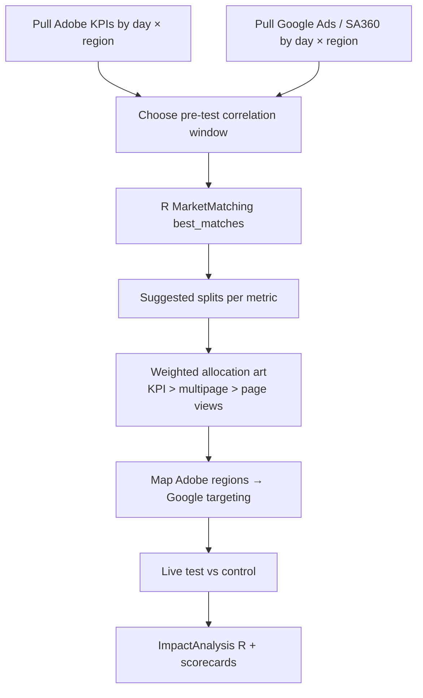

# Geo-holdout testing

Celebrity Cruises geo-holdouts (test & learn) split UK regions into **test** and **control** cells so we can change media in the test cell (e.g. targeting strategy or Brand Search) and measure incremental lift vs matched controls.

**Primary folder:**  
`…\Analytics\Celebrity Cruises\Geo-Holdout Testing\`

| Wave folder | Focus |
|---|---|
| `AUG 2023\` | Early CC geo matching + impact (`CC_MarketMatching_2023.R`, `CC\ImpactAnalysis.R`, August test reports) |
| `OCT 2023\` | Matured process — location matching, impact R, scorecard packs, Process Document |
| `Google Trends vs Bookings\` | Supporting UK vs US Google Trends vs bookings exploration |

---

## Why we run them

Example (Oct 2023 Process Document): measure the effect of **re-addressing targeting** — opening Celebrity to a broader behavioural set — without relying only on platform last-click.

Outcomes are framed as **incrementality** on web KPIs (funnel / bookings), with supporting volume metrics — not as a full MMM.

---

## End-to-end process

### 1. Data pulls

From the Oct 2023 Process Document:

| Source | Grain | Metrics (examples) |
|---|---|---|
| **Adobe** — “T & L Key metrics report” | Day × region; test year + prior year equivalent window | **KPI:** CEL Funnel Entries; **Support:** multipage visits (preferred volume), page views, visits, unique visitors, confirmation page visits, direct booking revenue |
| **Google / SA360** | Day × county (matched to Adobe) | Impressions, clicks, cost |

Keep pre-test and in-test windows aligned across sources (e.g. Jun–Oct Sat–Sun comparable weeks YoY when checking stability).

### 2. Pre-test correlation check

Compare 2023 vs 2022 regional trends (R² on KPI / supporting metrics). Use a stretch of **high correlation** as the pre-test matching window so pairs are stable before the intervention.

### 3. Location matching (R — `MarketMatching`)

Script pattern (e.g. `bestmatches - celebrity Oct 2023.R` under `OCT 2023\1 ) location matching\`):

1. Place CSVs next to the script (`Adobe 2022.csv`, `Adobe 2023.csv`) with `date`, `regions`, and metric columns.
2. Set `pretest_start` / `pretest_end`, `warping_limit` (typically 7), `dtw_emphasis = 0` (correlation match), `matches` (e.g. 20).
3. Run `MarketMatching::best_matches` with `suggest_market_splits = TRUE`.
4. Outputs per metric: `*-best.csv` and `*-suggested.csv` (plus combined RDS / Excel artefacts).

Aug 2023 used the same family of tooling (`CC_MarketMatching_2023.R`) with LAD / ITL region mapping under `Region Mapping\`.

### 4. Allocation (art + science)

Suggested splits are **not** used blindly:

1. Agree priority metrics with biddable (KPI mandatory; multipage visits next; page views third).
2. Combine suggested splits in a workbook (e.g. `Combined Results.xlsx`) with a **weighted score** (−1 control … +1 test); KPI weight highest.
3. Map Adobe regions → **Google geo targets** via lookup (`Google Region - Adobe Region LU.csv.xlsx`). Google geos are coarser — roll Adobe scores up with a weighted average (often by average multipage visits).

{: .important }
> Avoid **halo** across borders: cells that are too small or adjacent let people’s movement contaminate test vs control. Regions should be like-for-like on historic Brand / non-Brand spend, other media (TV/OOH skew), interest (site activity), and historic KPI.

### 5. Impact analysis

During / after the live window, `ImpactAnalysis - celebrity Oct 2023.R` (and dated scorecard variants):

1. Load tagged regional daily file (`group` = TEST / CONTR).
2. Aggregate test and control panels.
3. Use `MarketMatching::inference` (CausalImpact-style) with matched markets / betas for the exposed locale.
4. Produce scorecard packs under `Report Scorecard_*\` folders.

Aug 2023 impact lived under `AUG 2023\CC\ImpactAnalysis.R` with brand-increment CSVs and successive “till DD Mon” Excel reports.

---

## Waves on file

### August 2023

- Matching + impact under `AUG 2023\`
- Deliverables: `August 2023 test report*.xlsx`, `bestmatches_CC_*.xlsx/csv`
- Region LUTs: `Region Mapping\LAD21_…`

### October 2023

- Clearest **process write-up**: `OCT 2023\2) Impact Analysis\Process Document.txt`
- Matching: `1 ) location matching\`
- Impact + scorecards: `2) Impact Analysis\`
- Reports: `october 2023 test report*.xlsx`

### Supporting

- `Google Trends vs Bookings\` — UK vs US trends workbooks for demand context

---

## Ops tips

{: .tip }
> Keep the Adobe ↔ Google region lookup maintained — Google targets change and the LUT is noted as not exhaustive.

{: .note }
> Working paths in Process Document still reference the old `Z:\Shared\london\…` share; current copies are under the Interpublic SharePoint Analytics tree linked above.
