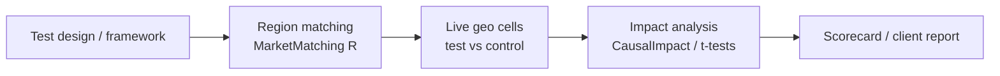

# Celebrity Cruises

Documentation for analytics work on the Celebrity Cruises account — primarily **geo-holdout / test-and-learn** experiments on Brand Search and related media.

## Pages in this section

| Page | What it covers |
|---|---|
| [Geo-holdout testing](geo-holdout-testing) | How we design, match regions, run, and measure geo-holdouts (Aug / Oct 2023 waves) |
| [Brand Search tests](brand-search-tests) | Brand Search incrementality frameworks — August 2024 (Brand → Meta) and January 2025 (Brand on/off) |

## Working folders (SharePoint)

Artefacts live under Mediahub Analytics UK Shared Documents:

`…\Analytics\Celebrity Cruises\`

| Folder | Role |
|---|---|
| `Geo-Holdout Testing\` | Historic T&L waves (AUG 2023, OCT 2023), region matching, impact R scripts, scorecards |
| `Brand Search Test August 2024\` | Proposed framework for shifting Brand Search → Meta |
| `Brand Search Test - January 2025\` | Brand Search on/off geo-holdout — location matching, Google/Adobe pulls, grouped data |

