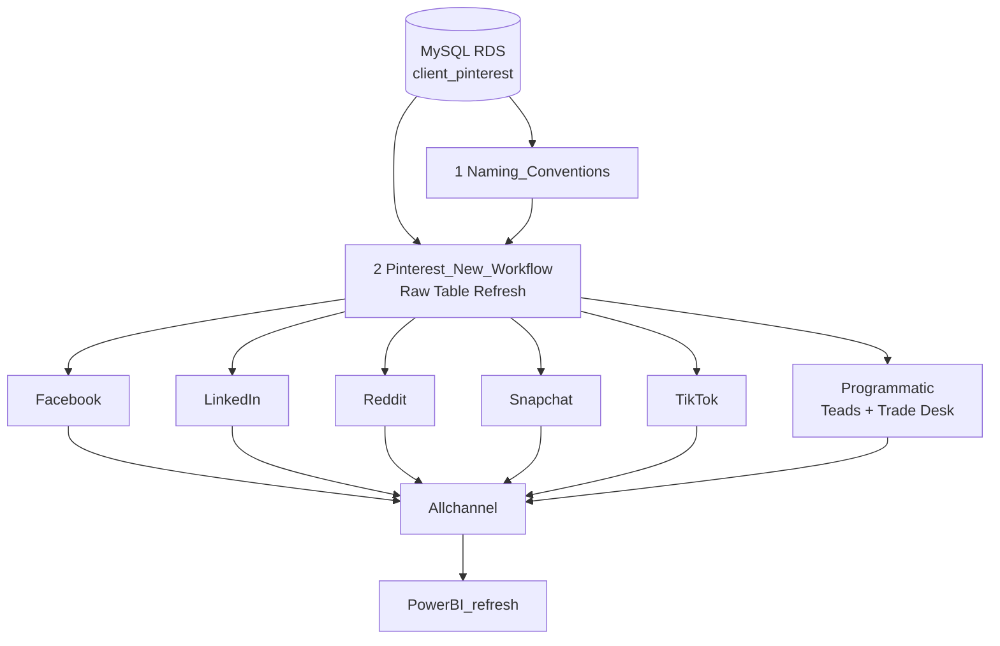

# Pinterest

Engineering documentation for the **Pinterest Data Refresh** Databricks job — daily automation that lands partner delivery + naming conventions into Delta, builds per-channel gold creative tables, unions an all-channel summary, and refreshes Power BI.

{: .important }
> Job: [Pinterest Data Refresh](https://dbc-341b6afb-df67.cloud.databricks.com/jobs/657198646939030?o=7058903129942627) (`657198646939030`)  
> Schedule: Daily **07:00 UTC** (`14 0 7 * * ?`), **UNPAUSED**  
> Notebooks: `/Repos/anas.ahmed@mediahubww.com/datastream-etl/etl/pinterest/Job/…`  
> Cluster (most tasks): `0908-154440-758js3qc`  
> Failure email: `anas.ahmed@mediahubww.com`, `ernest.amoako@mediahubww.com`

---

## Upstream → downstream

| Stage | Task key | What lands |
|---|---|---|
| **Upstream** | — | Adverity / Signal MySQL `client_pinterest` partner DBs + naming convention tables |
| **1** | `Naming_Conventions` | Overwrite `raw.pinterest.av_*_naming_convention` |
| **2** | `Pinterest_New_Workflow` | Overwrite raw delivery + selected NC tables from JDBC |
| **3 (parallel)** | Facebook, LinkedIn, Reddit, Snapchat, TikTok, Programmatic | Per-partner `uc_dev.pinterest.gold_*_creative` (+ namingconvention) |
| **4** | `Allchannel` | Union → `gold_allchannel_summary` + `gold_allchannel_namingconvention` |
| **5** | `PowerBI_refresh` | Refresh Power BI model in workspace **Pinterest x Mediahub** |

---

## Pages in this section

| Page | Notebook / task |
|---|---|
| [Naming convention refresh](naming-convention-refresh) | `Pinterest Naming Convention Raw Refresh` |
| [Raw table refresh](raw-table-refresh) | `Pinterest Raw Table Refresh` |
| [Social channels](social-channels) | Facebook, LinkedIn, Reddit, Snapchat, TikTok |
| [Programmatic](programmatic) | Teads + The Trade Desk |
| [All channel](all-channel) | Union + validation + naming union |
| [Power BI refresh](power-bi-refresh) | Job Power BI task |

{: .warning }
> The Naming and Raw notebooks currently embed a JDBC password in source. Prefer Databricks secrets (`dbutils.secrets`) — do not copy credentials into this wiki or into new notebooks.
