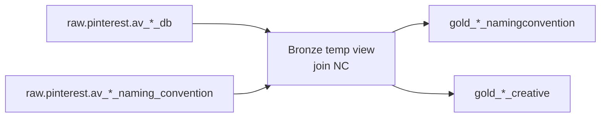

# Social channels

**Depends on:** `Pinterest_New_Workflow` (all run in parallel after raw refresh)  
**Cluster:** `0908-154440-758js3qc`  
**Failure email:** `anas.ahmed@mediahubww.com` (per social task)

Each social notebook turns raw delivery + naming convention into two gold tables: a **parsed namingconvention** table and a standardised **creative** fact table under `uc_dev.pinterest`.

---

## Shared pattern

1. **Bronze** — left-join delivery to deduped naming convention; build `naming_string` via `coalesce` of NC vs delivery name fields.
2. **UK first** — `DROP`/`CREATE` gold naming + creative tables for UK accounts.
3. **US second** — `INSERT INTO` the same gold tables for US accounts (Reddit is **UK only**).
4. **Parse NC** — split underscore chunks into type, phase, geo, targeting, placement_type, device, kpi, creative, ad_length, dimensions, start/end week.
   - **2025** strings: **17** chunks (weeks at positions 15–16)
   - **2026** strings: **19** chunks (weeks at 17–18)
   - `error_count` if name does not contain `%PIN1%` or chunk count is wrong
5. **Creative gold** — common schema: date, geo, channel=`Paid Social`, phase, partner, meta_placement, placement_type, targeting, ad_length, creative, weeks, placement_name, currency, impressions, clicks, video funnel, `media_cost`.
6. **Filters** — typically `impressions > 0` and `media_cost > 0`; geo via account / advertiser IDs.
7. **Validation** — compare raw vs bronze spend (Facebook hard-fails in Python if variance is too high).

---

## Facebook (`Social/Facebook`)

| | |
|---|---|
| **Task** | `Facebook` |
| **Inputs** | `raw.pinterest.av_facebook_adset_db`, `av_facebook_naming_convention` |
| **Outputs** | `uc_dev.pinterest.gold_facebook_namingconvention`, `gold_facebook_creative` |

- NC keys: account_id, adset_id, creative_id, day → `ad_name`
- `naming_string = coalesce(ad_group, nc.ad_name)`
- Partner from platform: Facebook / Instagram / Meta; clicks = URL clicks; video_starts ≈ 3s views
- UK accounts (GBP) vs US accounts (USD); excludes campaign `Pinterest Engagement Growth Campaign 2025` on UK
- Only social notebook with real `meta_placement` (`platform_position`)
- **Python hard-fail** if spend variance > 0.1%

---

## LinkedIn (`Social/LinkedIn`)

| | |
|---|---|
| **Task** | `LinkedIn` |
| **Inputs** | `av_linkedin_creative_db`, `av_linkedin_naming_convention` |
| **Outputs** | `gold_linkedin_namingconvention`, `gold_linkedin_creative` |

- NC keys: account_id, campaign_id, creative_id, date
- UK account `512354824` (GBP); US `512360006`, `512301007` (USD)
- `meta_placement = 'N/A'`; video_starts mapped from p25 (not true starts)
- Creative column often carries full `naming_string`

---

## Reddit (`Social/Reddit`)

| | |
|---|---|
| **Task** | `Reddit` |
| **Inputs** | `av_reddit_adset_db`, `av_reddit_naming_convention` |
| **Outputs** | `gold_reddit_namingconvention`, `gold_reddit_creative` |

- **UK only** (no US insert)
- Large `ad_name NOT IN (...)` exclusion list for 2025 CTO Music/Podcast & Fashion/Beauty package ads
- Validation allows bronze &lt; raw because of exclusions; fails if bronze &gt; raw

---

## Snapchat (`Social/Snapchat`)

| | |
|---|---|
| **Task** | `Snapchat` |
| **Inputs** | `av_snapchat_creative_db`, `av_snapchat_naming_convention` |
| **Outputs** | `gold_snapchat_namingconvention`, `gold_snapchat_creative` |

- UK / US account UUIDs; currency from source
- `naming_string = coalesce(db.ad_name, nc.ad_name)` (DB preferred — opposite of several peers)
- video_starts = `video_watched_2s`

---

## TikTok (`Social/Tiktok`)

| | |
|---|---|
| **Task** | `Tiktok` |
| **Inputs** | `av_tiktok_creative_db`, `av_tiktok_naming_convention` |
| **Outputs** | `gold_tiktok_namingconvention`, `gold_tiktok_creative` |

- Keys use advertiser_id / ad_group_id / ad_id (not account/adset/creative)
- UK advertiser `7143011201729953794`; US `7131084766463524866`
- Partner spelling **`Tiktok`**; video_starts = `video_watched_2s`
- Extra engagement fields may exist in bronze; gold keeps the standard funnel

{: .note }
> After all social + programmatic tasks succeed, [All channel](all-channel) unions their creative (and naming) gold tables.
