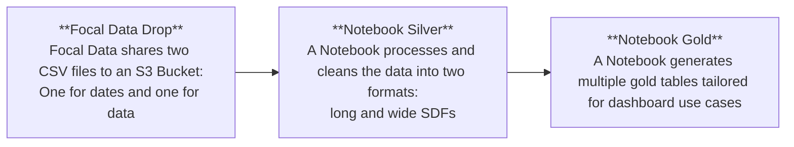

# The Architecture

Brand Pulse has been migrated to the repo [BrandPulse](https://github.com/Mediabrands-MHW-LDN-Github/BrandPulse).

---

## High-Level Flow

---

## Tables Available

### Bronze

The `bronze_brandpulse` table serves as the foundational raw data layer. It merges the date and data files from the S3 bucket, storing survey questions and responses in their unprocessed format.

**Key Features:**
- Contains raw survey data as ingested.
- Captures metadata like question text, responses, and timestamps.

---

### Silver

The Silver tables provide a cleaned and standardized version of the data, addressing inconsistencies and variations in survey responses.

**Key Improvements:**
- Harmonizes terminology differences across regions (e.g., “trainer” vs. “sneaker”).
- Adjusts for changes in question formats or response options over time.

**Available Tables:**
- **`silver_brandpulse_long`**: A long-format table with columns such as `respondent_id`, `question`, and `response`. Each row represents a unique question-response pair for a respondent.
- **`silver_brandpulse_wide`**: A wide-format table where each question-response pair is represented as a column. Rows are unique by `respondent_id` and `wave`.

---

### Gold (New Balance)

The Gold tables are designed to meet specific use-case requirements for New Balance dashboards. Each table is tailored to provide actionable insights.

1. **`gold_brandpulse_meta`**
   - Contains respondent metadata (e.g., age, country, gender, audience).
   - Unique rows by `respondent_id` and `wave`.

2. **`gold_brandpulse_funnel`**
   - Tracks brand funnel metrics such as awareness, consideration, purchase intent, and mentions.
   - Unique rows by `respondent_id`, `wave`, and `brand`.

3. **`gold_brandpulse_audience`**
   - A long-format table capturing respondent-audience associations.
   - Columns include `respondent_id`, `wave`, `audience`, and a binary flag (`1` if the respondent matches the audience).

4. **`gold_brandpulse_celeb`**
   - Focuses on celebrity associations and familiarity.
   - Similar to the funnel table, with unique rows by `respondent_id`, `wave`, and `celeb`.

5. **`gold_brandpulse_multianswer`**
   - Handles questions with multiple answers and no consistent denominator (e.g., brands, celebrities).
   - Includes columns for a generalized question category (`funnel`), cleaned responses, and the original question number for filtering.

6. **`gold_brandpulse_brandassociation`**
   - Tracks associations with New Balance slogans, such as “Run Your Way” and “We Got Now.”
   - Unique rows by `respondent_id`, `wave`, and `brand`.
   - Null values in the `ryw` and `wgn` columns reflect changes in question formats over time.

