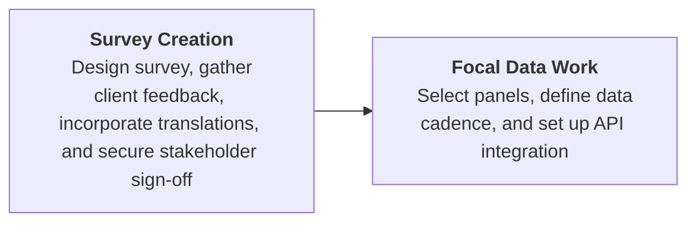
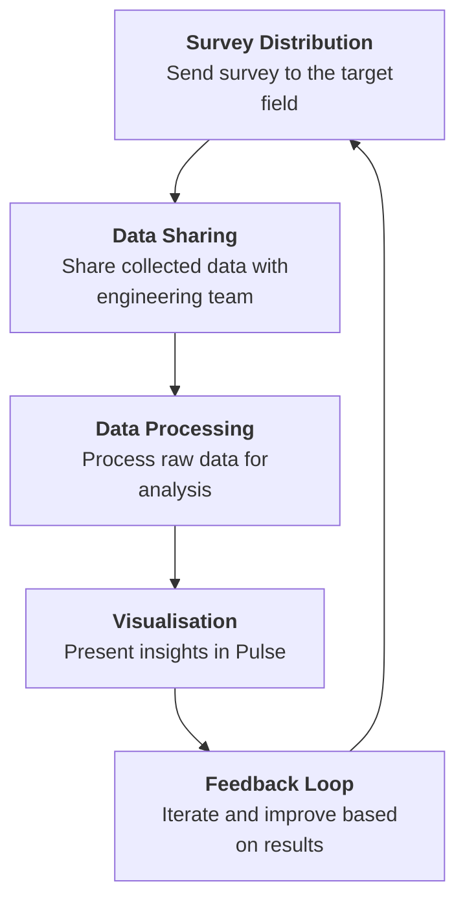

# Brand Pulse

A continuous, category-contextualized understanding of a brand's health to drive better media decisions for stronger business outcomes.

### Why do we need Brand Tracking?
To inform effective media efficiency, it is essential to understand the impact of media and advertising on key brand health metrics continuously. By linking changes in these metrics to specific campaign outcomes, we can demonstrate campaign effectiveness and support a data-driven, local-to-global media insight approach.

### The Setup Phase

### The Ongoing Process

