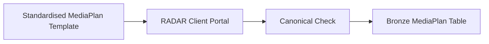
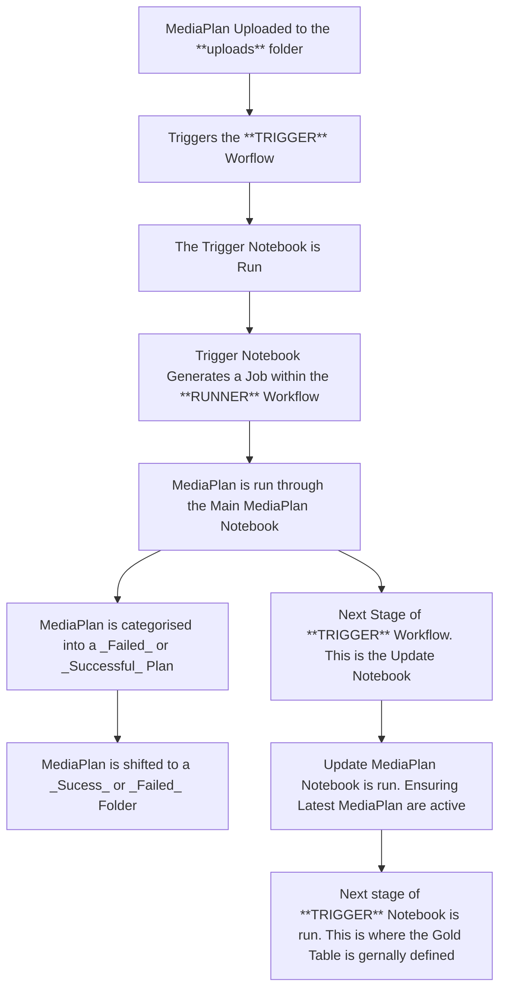

# RADAR

## Overview

RADAR aims to unify online and offline media data to enable greater and granular analysis of media activity. 

## MediaPlan Template

This starts with the MediaPlan Template which is standardised. Example file here. 

Work with Roland and the Account Director for the client to help inform the template and make changes to this. 

## General Workflow

## Technical Workflow

What  happens in databricks after a file is uploaded into the `uploads` folder. 

## Testing