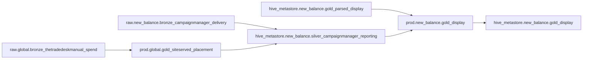

# Site Served Data

The purpose of the siteserved pipeline is to ensure DSP data can be ingested into Campaign Manager through the `prod.global.gold_siteserved_placement` table manually. You use this process if you're finding that display data is missing from the gold_display table and you need to fill it with the missing data. 

This is done through reading the files in the S3 bucket `mh-rawdata-global` 
The notebook looks for the S3 Bucket path `global/display/dsp_spend` 
And then loops through the `AVAILABLE_CHANNELS` in the constant file (expecting folders with the same name). 

{: .important}
There is a date range in the Site served notebook so if you are doing historicals then you will need to apply a changed date range


Have a read through of the README file in the siteserved folder to understand how to add a new channel. 


This is what the siteserved process look for New Balance: 




This is what the TaxonomyChecker process looks like in order to create hive_metastore.new_balance.gold_parsed_display which is joined with the hive_metastore.new_balance.silver_campaignmanager_reporting in order to create prod.new_balance.gold_display:

```mermaid
graph LR;
    raw.new_balance.bronze_campaignmanager_naming_conv --> prod.new_balance.silver_namingconv_input;
    prod.new_balance.silver_namingconv_input --> prod.new_balance.silver_namingconv_output;
    prod.new_balance.silver_namingconv_output --> prod.new_balance.gold_namingconv_signaloutput;
    prod.new_balance.gold_namingconv_signaloutput --> hive_metastore.new_balance.gold_namingconvention_output;
    hive_metastore.new_balance.gold_namingconvention_output -->  hive_metastore.new_balance.gold_parsed_display;
```



# DSP Spend Processing Pipeline

## Overview

Most of this pipeline must be run using a **Unity-enabled cluster**, specifically the **DataOps Shared Compute Cluster (dev uc)**.

## Manually Uploading a CSV File

If you need to manually upload a CSV file with missing spend data, follow these steps:

1. Ensure the CSV follows the structure of existing files.
2. Upload the file to the S3 location:
   ```
   s3://mh-rawdata-global/global/display/dsp_spend/thetradedeskmanual/
   ```
3. **Formatting requirements:**
   - The CSV file must **not** contain commas.
   - Use **`;`**** (semicolon)** as the delimiter.
   - You can use **Sublime Text Editor** or **Notepad++** to ensure proper formatting.

## Important Columns for Processing

The following columns in the CSV file are required for processing:

- `dt_filename`
- `placement_adset_id`
- `impressions`
- `media_spend`
- `currency`

All other columns are **not necessary** for filling in missing spend.

## Spend Calculation in `gold_display` Tables

- Spend is calculated using **CPI (Cost Per Impression)**:
  ```
  cpi = media_cost / impressions
  spend = cpi * impressions
  ```
- `impressions` are sourced from:\
  `raw.new_balance.bronze_campaignmanager_delivery`

## Platform Column in `gold_display`

- In the **gold\_display table**, the `publisher` column is equivalent to `platform`.
- The reason for this mapping is unclear, but it may be due to:
  - More **null values** in the `platform` column.
  - Users being more likely to fill in the `publisher` section of `placement_adset_name`.

## Platform Lookup in `TaxonomyChecker`

- A lookup in the **TaxonomyChecker pipeline** fills in platform data.
- This is necessary because users often enter incorrect values in `placement_adset_name`.
- The lookup can be found here:\
  [Taxonomy Lookup Constants](https://github.com/Mediabrands-MHW-LDN-Github/TaxonomyChecker/blob/main/constants.py)
- The notebook using the lookup is located here:\
  [Gold Table Processing Notebook](https://github.com/Mediabrands-MHW-LDN-Github/TaxonomyChecker/blob/main/parsed/New%20Balance%20-%20Gold%20Table.py)

---

This README provides the necessary details for managing DSP spend data within the pipeline. Ensure that all manual uploads follow the guidelines to avoid processing errors.


