# Site Served Data

The purpose of the siteserved pipeline is to ensure DSP data can be ingested into Campaign Manager through the `prod.global.gold_siteserved_placement` table manually. You use this process if you're finding that display data is missing from the gold_display table and you need to fill it with the missing data. 

This is done through reading the files in the S3 bucket `mh-rawdata-global` 
The notebook looks for the S3 Bucket path `global/display/dsp_spend` 
And then loops through the `AVAILABLE_CHANNELS` in the constant file (expecting folders with the same name). 

{: .important}
There is a date range in the Site served notebook so if you are doing historicals then you will need to apply a changed date range

Have a read through of the README file in the siteserved folder to understand how to add a new channel. 

This is what the siteserved process look: 

```mermaid
graph LR;
    accTitle: Very High Level Overview
    accDescr: Tables Overview
    raw_global_bronze_thetradedeskmanual_spend --> prod_global_gold_siteserved_placement;
    prod_global_gold_siteserved_placement --> hive_metastore_new_balance_silver_campaignmanager_reporting;
    hive_metastore_new_balance_silver_campaignmanager_reporting --> hive_metastore_new_balance_gold_parsed_display;
    hive_metastore_new_balance_gold_parsed_display --> prod_new_balance_gold_display;
    prod_new_balance_gold_display --> hive_metastore_new_balance_gold_display;

```

```mermaid
graph LR;
    raw_new_balance_bronze_campaignmanager_naming_conv --> prod_new_balance_silver_namingconv_input;
    prod_new_balance_silver_namingconv_input --> prod_new_balance_silver_namingconv_output;
    prod_new_balance_silver_namingconv_output --> prod_new_balance_gold_namingconv_signaloutput;
    prod_new_balance_gold_namingconv_signaloutput --> hive_metastore_gold_namingconvention_output;
    hive_metastore_gold_namingconvention_output --> hive_metastore_new_balance_gold_parsed_display_campaign;
    hive_metastore_new_balance_gold_parsed_display_campaign --> hive_metastore_new_balance_gold_parsed_display_adset;
    hive_metastore_new_balance_gold_parsed_display_adset --> hive_metastore_new_balance_gold_parsed_display_ad;

    hive_metastore_new_balance_gold_parsed_display_campaign -->|joined with| hive_metastore_new_balance_gold_parsed_display_adset;
    hive_metastore_new_balance_gold_parsed_display_adset -->|joined with| hive_metastore_new_balance_gold_parsed_display_ad;

```

- In order to manually upload a CSV file with the missing spend, you must adhere to the structure of the other files and put it in the s3 location: s3://mh-rawdata-global/global/display/dsp_spend/thetradedeskmanual/
- Make sure CSV file has no commas and is delimited by ; (can use Sublime text editor or Notepad++)
- The main columns that matter in the CSV file for processing are dt_filename, placement_adset_id, impressions, media_spend & currency. Currently, all the other columns are not necessary for filling in missing spend
- Please be wary that spend is calculated by for calcualting the CPI

