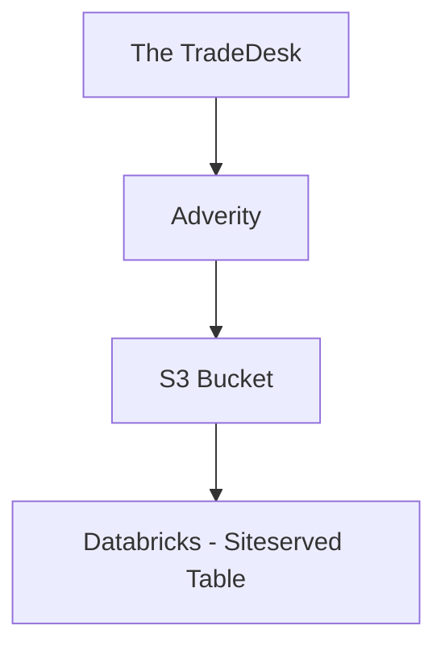

# The Trade Desk pipeline

The Trade Desk spend data gets pulled from a report called "Global | TTD | SpendPlacement" and into an Adverity datastream also called "Global | TTD | SpendPlacement." If you need to add a new column, delete a column or edit the report in some kind of way, you need to create a brand new report and await 24 hours before it appears in Adverity. Broadly, this is what the pipeline looks like:

## How to create a new report to pull from Trade Desk to Adverity

Use the account "ttd_api_multipartner_adverity@mediahubww.com" to create a report in The TradeDesk. When you create a report always use one of the pre-created templates, otherwise it won't appear in The TradeDesk: 

## Things to note are:

- You often have to wait a full 24 hours before the report appears in Adverity,
- Make sure you use the same ttd_api_multipartner_adverity@mediahubww.com authentication in Adverity,
- Take note of where you create the report in TradeDesk (is it in the New Balance advertiser account, the Celebrity Cruises advertiser account, the Mediahub Partner Seat?) as this could influence where you see the report in Adverity when you use the advertiser/partner dropdowns:

