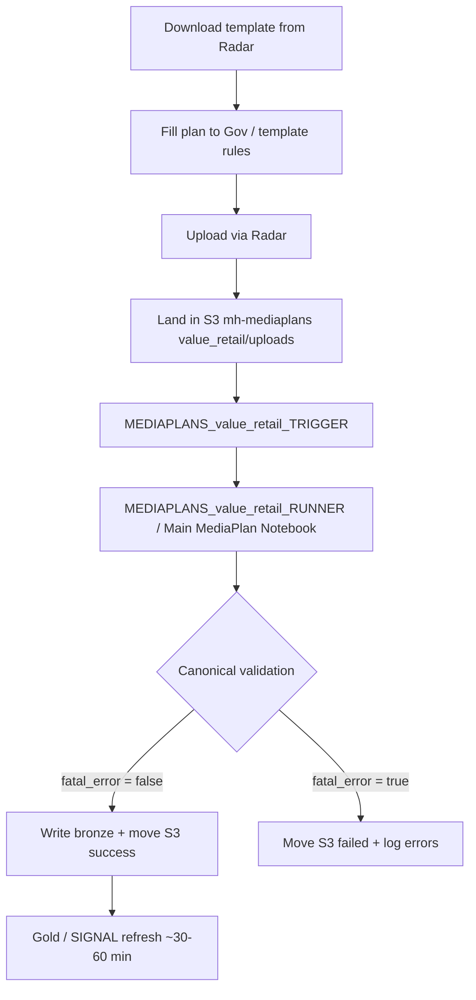

# Ingestion process

How a Value Retail mediaplan moves from Radar into Databricks bronze / gold online.

## Key links

| Resource | Link |
|---|---|
| Template download (Radar) | [Value Retail Radar](https://prod.d2oohu4fo82r82.amplifyapp.com/valueretail/radar#) |
| Canonical dashboard | [Canonical](https://prod.d2oohu4fo82r82.amplifyapp.com/valueretail/apps/canonical) |
| SIGNAL mediaplan report | [Mediahub Client Portal report](https://prod.d2oohu4fo82r82.amplifyapp.com/valueretail/apps/signal/reports/3607c9bb-2a9d-49b9-9d1f-b067457690a2) |
| Governance Inputs | [Google Sheet](https://docs.google.com/spreadsheets/d/1rYsIpscgFCDN_YX6TnDEp9ZCfm_C8O_CZ1pZNv25n04/edit?gid=1900709516#gid=1900709516) |

---

## Flow

1. Planner downloads the current template from Radar and fills it using Governance Inputs (Shared values dropdowns, layout rules).
2. Upload on Radar drops the `.xlsx` into S3 `uploads/`.
3. **Trigger** lists new uploads, diffs against `gold_mediaplan_canonical`, applies exclusion list, then launches the **Runner** with `RUN_ENV`, `filename`, `client_name`.
4. **Runner** loads Gov Inputs from the Google Sheet, preprocesses Excel (unmerge), runs canonical checks, transforms channel tabs, and on success writes bronze then moves the file to S3 success.
5. Gold / SIGNAL catch up (~30–60 min). Confirm in Canonical and the mediaplan dashboard.

Radar also surfaces which plans succeeded or failed for non-technical users.

---

## Trigger vs Runner (Databricks)

| Workflow / notebook | Role |
|---|---|
| `Trigger Notebook Version` → `MEDIAPLANS_*_TRIGGER` | Watch S3 `uploads/`, skip excluded filenames, enqueue Main job (concurrency 3) |
| `Main MediaPlan Notebook` → `MEDIAPLANS_*_RUNNER` / job `917354567508597` (VR) | Validate + transform + bronze write + S3 success/failed |
| `Update MediaPlan Tables` | Active / Inactive state maintenance (separate from ingest) |

{: .tip }
> For what must be true in the Excel before ingest succeeds, see [Successful plan rules](successful-plan-rules). For post-upload checks, see [QA checklist](qa-checklist).
