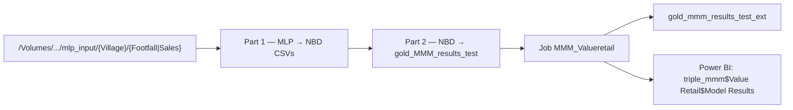

# Dashboarding Phase

Pre-dashboard processing that turns **MLP (Modelbuilder) village results** into the tables behind the Triple MMM Power BI dashboard, then refreshes the semantic model.

> **In one line:** MLP outputs → NBD-shaped files → dashboard Delta tables → Power BI refresh.

| Step | Artifact | Role |
|---|---|---|
| [1 — MLP → NBD](step-1-mlp-to-nbd) | Part 1 notebook (Matt Crisp workspace) | Per-village MLP transforms → FileStore NBD CSVs |
| [2 — NBD → dashboard tables](step-2-nbd-to-powerbi) | Part 2 notebook (Maria Zakharova workspace) | Long-format join, categories, %s → Delta |
| [3 — Historic + Power BI refresh](step-3-historic-and-refresh) | Job `MMM_Valueretail` (`923649884874091`) | Extend/patch results + refresh DirectQuery model |

{: .note }
> Parts 1 and 2 are still run from user workspace notebooks (not yet tasks on the job). The scheduled / table-triggered job starts at **Historic MMM Data**, then refreshes Power BI when `uc_dev.value_retail.gold_mmm_results_test` updates.

{: .tip }
> For documentation on the **dashboard views themselves** (breakdowns, update steps), see [Value Retail → Dashboards](../../dashboards/).
