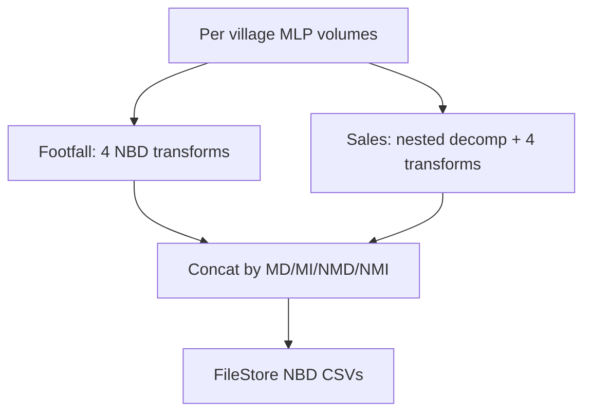

# Step 1 — MLP to NBD

**Notebook:** `/Users/matt.crisp@mediahubww.com/NBD Workflows/Value Retail Model Pipeline/(Clone) Final PowerBI Pipeline Part 1`  
**Purpose:** Convert Modelbuilder (MLP) footfall and sales results into **NBD2-shaped** files, one set per audience brand, ready for Part 2.

Depends on NBD2 code under `/Workspace/Repos/gavi.vignes@mediahubww.com/NBD2/` (`MLPtoNBDPipeline`, `RobynWrapper`).

---

## Inputs

| Input | Location |
|---|---|
| Latest MLP data / results files | `/Volumes/uc_raw/value_retail/mlp_input/{Village}/Footfall/` and `.../Sales/` |
| Villages | BV, FV, IV, KV, LR, LV, LZ, MV, WV (9) |

For each village, `get_latest_file()` picks the newest files whose names contain `data` or `results`.

{: .note }
> Sales `raw_mlp_data` deliberately uses the **Footfall** data path (nested model). Sales `model_results` comes from the Sales folder.

---

## What the notebook does

### Per village (repeated for all 9)

1. **Footfall pipeline** — `MLPtoNBDPipeline` runs four transforms:
   - `raw_data`
   - `pareto_aggregated`
   - `pareto_alldecomp_matrix`
   - `hyperparameters`
2. **Sales pipeline** — same four transforms, plus **`run_nested_decomposition()`** first, with the footfall pipeline passed as a dependency.

### Across villages

3. Collect outputs by brand (**MD**, **MI**, **NMD**, **NMI**).
4. For `pareto_hyperparams` only, drop numeric columns that sum to 0.
5. Rename `market` → `country_code`.
6. `pd.concat` all villages per brand with `fillna(0)`.
7. Rename KPI columns (e.g. `FOOTFALL` → `footfall_domestic_member`, `SALES` → `Sales_Domestic_member`).

### Export

8. Write CSVs under:
   `/dbfs/FileStore/user/gavi/NBD/VR_BV/outputs/{footfall|sales}/{MD|MI|NMD|NMI}/`
9. Four files per brand: `raw_data.csv`, `pareto_aggregated.csv`, `pareto_alldecomp_matrix.csv`, `pareto_hyperparameters.csv`.

---

## Output consumed by Part 2

Primarily the **`pareto_alldecomp_matrix.csv`** and **`raw_data.csv`** files under the footfall and sales brand folders above.

{: .warning }
> Village concat uses `fillna(0)`, which can inflate row counts vs sparse NaNs. Part 2 also consolidates `*_indirect` columns — totals can differ from raw Part 1 decomp if you compare unfiltered.

---

## Related

- Next: [Step 2 — NBD to Power BI tables](step-2-nbd-to-powerbi)
- Upstream modelling inputs: [MMM Data Processing](../)
