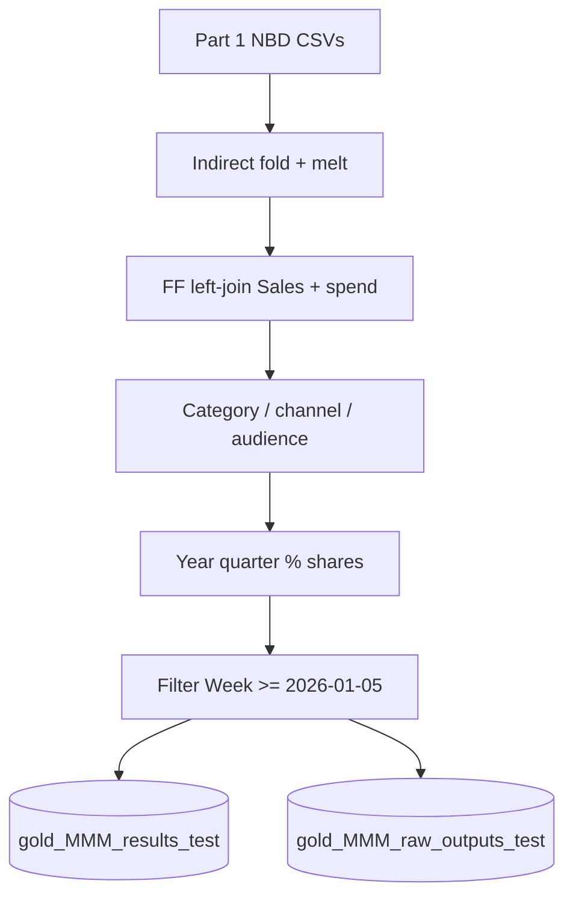

# Step 2 — NBD to Power BI tables

**Notebook:** `/Users/maria.zakharova@mediahubww.com/PowerBI pipeline/(Clone) FInal PowerBI Pipeline Part 2`  
**Purpose:** Take Part 1 NBD CSVs, reshape and enrich them for the Triple MMM dashboard, and write Unity Catalog Delta tables.

---

## Inputs

| File set | Path pattern |
|---|---|
| Footfall decomp | `/dbfs/FileStore/user/gavi/NBD/VR_BV/outputs/footfall/{MD\|MI\|NMD\|NMI}/pareto_alldecomp_matrix.csv` |
| Sales decomp | `.../sales/{brand}/pareto_alldecomp_matrix.csv` |
| Sales raw (spend / outcomes) | `.../sales/{brand}/raw_data.csv` |

---

## What the notebook does

1. **Reshape decomp** — For each brand CSV, fold `*_indirect` into the base column, then melt wide → long (`variable`, `Incremental FF` / later `Incremental Sales`).
2. **Join FF ← Sales** on `ds`, `country_code`, `BRAND`, `variable` (left join).
3. **Spends** — Melt sales `raw_data`, keep `variable` containing `spend_`, merge onto the decomp frame (`fillna(0)`).
4. **Drop** rows where `variable` ∈ `dep_var`, `depVarHat`, `season`.
5. **Categories** — Map variables to major/minor groups (e.g. Village Media, DB Media, Client DB Media, PR, Organic, Base & Other) via `CATEGORY_MAJOR_MAPPING` / `CATEGORY_MINOR_MAPPING`.
6. **Labels** — `Group` (MEDIA vs BASE), `Type` (Village / Direct Buy / Collection / ALL), `Master Channel`, `Granular Master Channel`, `Audience` (DOMESTIC / DESTINATION / SOURCE).
7. **Calendar** — Year, Quarter, Half Year from `ds`.
8. **Share metrics** — Village / channel / channel×village % of incremental FF and sales (annual and quarter; half-year cols dropped before write).
9. **Rename for dashboard** — e.g. `ds` → `Week`, `country_code` → `Village`, `BRAND` → `Membership` (Member Domestic, etc.).
10. **Raw outcomes table** — Pivot footfall / sales outcome columns for a companion raw outputs frame.
11. **Date cut** — Keep rows with week ≥ **`2026-01-05`** (comment in notebook: change when rolling a new quarter).
12. **Write Delta** via `write_mmm_tables(..., mode="auto_partial_overwrite")`:
    - Deletes existing rows from the min date of the batch onward, then appends
    - Results: `uc_dev.value_retail.gold_MMM_results_test`
    - Raw: `uc_dev.value_retail.gold_MMM_raw_outputs_test`

---

## Outputs

| Table | Contents |
|---|---|
| `uc_dev.value_retail.gold_MMM_results_test` | Weekly incremental FF/Sales, spends, groupings, % columns — primary dashboard fact |
| `uc_dev.value_retail.gold_MMM_raw_outputs_test` | Pivoted raw footfall/sales outcomes by period × village × membership |

{: .important }
> Updates to `gold_mmm_results_test` (same logical table; UC case-insensitive) are what trigger job [Step 3](step-3-historic-and-refresh) via a table-update trigger.

---

## Related

- Previous: [Step 1 — MLP to NBD](step-1-mlp-to-nbd)
- Next: [Step 3 — Historic + Power BI refresh](step-3-historic-and-refresh)
