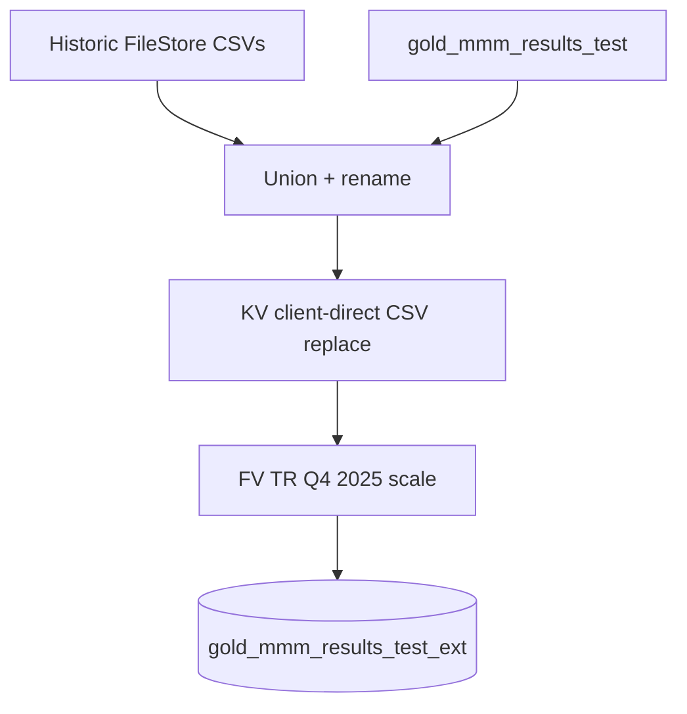

# Step 3 — Historic + Power BI refresh

**Job:** [MMM_Valueretail](https://dbc-341b6afb-df67.cloud.databricks.com/jobs/923649884874091?o=7058903129942627) (`923649884874091`)  
**Creator / run-as:** `anas.ahmed@mediahubww.com`  
**Cluster:** `0908-154440-758js3qc`  
**Trigger:** Table update on `uc_dev.value_retail.gold_mmm_results_test` (min 2 hours between triggers), **UNPAUSED**  
**On failure email:** `anas.ahmed@mediahubww.com`

This is the last stage before the live dashboard: stitch / patch the results table into an extended gold table, then refresh the Power BI model.

---

## Task chain

| Order | Task key | Type | What it does |
|---|---|---|---|
| 1 | `Historic_MMM_Data` | Notebook | `/Repos/DEV/.../MMMDashboardPipeline/Historic MMM Data` |
| 2 | `Refresh_PowerBI_MMM_Dashboard` | Power BI task | Refresh `triple_mmm$Value Retail$Model Results` after task 1 |

Depends-on: **1 → 2**.

---

## Task 1 — Historic MMM Data

**Notebook:** `/Repos/DEV/datastream-etl/etl/value_retail/job/MMMDashboardPipeline/Historic MMM Data`

### Build the extended results set

1. Load historic CSV slices from FileStore (`MMM_Result_PowerBi_v2_clean_final.csv`, `sheet_1_clean_final.csv` for post–2024-04-01), normalise column names, union them.
2. Align naming (e.g. marketing-events % columns, `Incremental_Sales`).
3. Fix FV Meta variable order for H1 naming (`spend_META_NONTEST_*` → `spend_META_*_NONTEST_*`) on `gold_mmm_results_test`.
4. Read live **`uc_dev.value_retail.gold_mmm_results_test`** (written by Part 2), clean/rename columns, cast incremental FF/Sales to int.
5. Union live + historic into one frame; remap dashboard labels (e.g. Village Media → Agency Buys; DB / Client DB Media → Direct Buys; LR/LZ DB Media → Direct Display Buys).

### Surgical patches (still in this notebook)

6. **KV Client Direct** — For KV, 2025-06-30 → 2026-03-30, remove three client-direct variables and replace from  
   `dbfs:/FileStore/user/anas/MMM Dashboard Inputs/KV_remodel_client_direct_channels_H2_2025_Q1_2026_ext.csv`  
   (isolation asserts so non-KV rows are unchanged).
7. **FV Traditional Radio Q4 2025** — Idempotent scale of Agency Buy `spend_TRADITIONAL_RADIO_DOMESTIC_FV` FF / sales / spend to documented New targets (skip if already at New).
8. Write **`uc_dev.value_retail.gold_mmm_results_test_ext`** (Delta overwrite + schema overwrite).

{: .note }
> Related one-off notebooks in the same `MMMDashboardPipeline` folder (Client Dashboard Update, FV_TR repairs, KV validate) support the same patches but are **not** separate tasks on this job.

---

## Task 2 — Refresh Power BI MMM Dashboard

| Setting | Value |
|---|---|
| Connection | `powerbi-clientsecret-auth` (OAuth) |
| Workspace | `Mediahub - Signal` |
| Model | `triple_mmm$Value Retail$Model Results` |
| Storage mode | **DIRECT_QUERY** |
| Overwrite existing model | `false` |
| Refresh after update | `true` |
| SQL warehouse | `a463da14fd376325` |

After Historic MMM Data succeeds, Databricks updates/refreshes the semantic model so the Triple MMM dashboard picks up `gold_mmm_results_test_ext` (and related DirectQuery sources).

---

## End-to-end handoff

| Upstream | This step | Downstream |
|---|---|---|
| [Part 2](step-2-nbd-to-powerbi) writes `gold_mmm_results_test` | Job extends → `_ext` + PBI refresh | Triple MMM ROI / Model Results PBIX in Mediahub - Signal |

---

## Related

- [Dashboarding Phase overview](./)
- [True Metrics](../../true-metrics/) (separate weekly spend × coefficient path; not this job)
