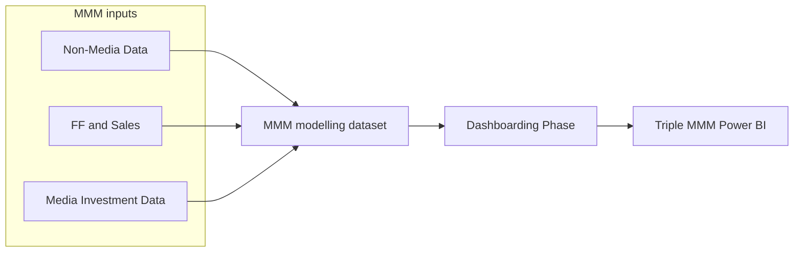

# MMM Data Processing

Overview of how Value Retail MMM modelling inputs are assembled, and how modelled results are prepared for the Triple MMM dashboard.

**MMM inputs = Non-Media Data + FF and Sales + Media Investment Data**  
**After modelling:** [Dashboarding Phase](dashboarding-phase/) (MLP → NBD → Delta → Power BI)

| Stage | Status | What it contributes |
|---|---|---|
| [Non-Media Data](non-media-data-processing/) | Documented (split by source) | Organic, email, PR, occupancy, weather, holidays, OECD, partnerships, etc. — joined onto the FF & Sales spine |
| [FF and Sales](ff-and-sales-data-processing) | Documented | Weekly sales, footfall, and Domestic / International member vs non-member splits (`gold_mmm_ffandsales`) |
| [Media Investment Data](media-investment-data/) | Documented | Versioned gold mediaplan + channel mapping; Search / Social / API Display–TikTok–YouTube–PMax aggregation |
| [Dashboarding Phase](dashboarding-phase/) | Documented | Part 1 MLP→NBD, Part 2 NBD→`gold_MMM_results_test`, job Historic + Power BI refresh |

{: .note }
> Input families feed modelling; the dashboarding phase is the post-model path into Power BI. Start from each child index for detail.
