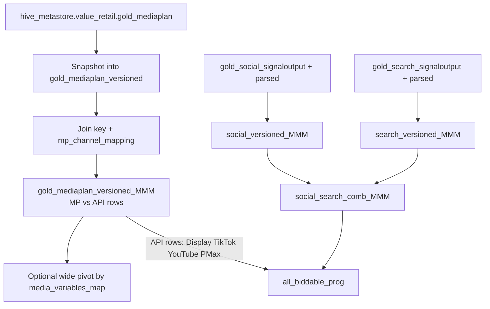

# Media Investment Data

Paid media spend for Value Retail MMM — versioned mediaplan snapshots, channel mapping to MMM variable names, plus Search / Social / API Display (TikTok, YouTube, Performance Max, Display) aggregated for modelling and QA.

{: .important }
> Notebook: [MMM Versioning Table](https://dbc-341b6afb-df67.cloud.databricks.com/editor/notebooks/3398733092082268?o=7058903129942627)  
> Path: `/Users/anas.ahmed@mediahubww.com/MMM Versioning Table`  
> Object ID: `3398733092082268`

---

## How the notebook is set up

| Stage | What it does |
|---|---|
| **Versioning** | Append a new `version_id` snapshot of live `gold_mediaplan` so mediaplan changes are never lost |
| **Channel mapping** | Build / refresh raw → clean MMM spend variable names; attach join keys on the latest version |
| **Mediaplan + API view** | Tag rows as `MP` vs `API` (`mediaplan_id = SIGNALDATA`); map to clean variables |
| **Search & Social** | Build Meta / Search signal views with Brand–VNT–Generic and HVA categories |
| **Aggregate** | Union Search + Social with API Display / TikTok / YouTube / Performance Max for biddable export |

---

## Pages in this section

| Page | Covers |
|---|---|
| [Versioning](versioning) | `gold_mediaplan_versioned` create / insert / delete workflow |
| [Channel mapping & mediaplan view](channel-mapping-and-mediaplan-view) | `mp_channel_mapping_*`, join keys, `gold_mediaplan_versioned_MMM` |
| [Search, Social & API aggregation](search-social-and-api) | Meta + Search views, union with API Display / TikTok / YouTube / PMax |

{: .note }
> Live mediaplans still flow through Radar → gold mediaplan (see [Mediaplans](../../mediaplans/)). This notebook **versions** that gold table for MMM and overlays Search / Social / API biddable sources.
