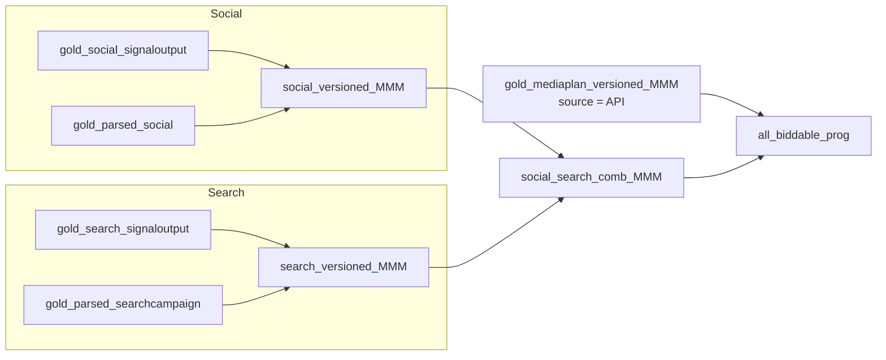

# Search, Social & API aggregation

Alongside versioned mediaplans, the notebook builds **biddable** spend from platform signal tables and unions it with **API** Display / TikTok / YouTube / Performance Max rows from the versioned mediaplan view.

---

## Social (`social_versioned_MMM`)

| | |
|---|---|
| **Spend source** | `hive_metastore.value_retail.gold_social_signaloutput` |
| **Taxonomy join** | `gold_parsed_social` on placement / ad / campaign IDs |
| **Filter** | `platform ILIKE '%Meta%'` |
| **Grain** | Day / week Monday × village × audience × social category × platform |

**Audience:** from parsed social, else inferred from campaign name (`DOMESTIC` / `DESTINATION` / `SOURCE`).

**Social category (HVA tests):**

| Rule | Category |
|---|---|
| 2024 Segments 345 / Meta3-5 / control group patterns | `HVA` |
| 2024 Acxiom / exposed group | `NonHVA` |
| 2025+ Acxiom on both campaign and placement | `HVA` |
| Else | `Non-Test` |

**Media variable pattern:**

`Social_{platform}_{social_category}_{audience_type}_spend`

Metrics summed: spend EUR/GBP, impressions, clicks.

---

## Search (`search_versioned_MMM`)

| | |
|---|---|
| **Spend source** | `value_retail.gold_search_signaloutput` |
| **Taxonomy join** | `gold_parsed_searchcampaign` on `campaign_id` |
| **Filters** | Channel not Performance Max-like (`NOT ILIKE '%max%'`), `year(day) >= 2025`, exclude Belmont Park |
| **Grain** | Day / week Monday × village × channel × audience × search category |

**Village** normalised from codes in the signal village field (BV, FV, …).

**Search category** from campaign / placement naming:

| Patterns | Category |
|---|---|
| Brand / Brndkw / KWprod / Brands | `Brand` |
| VNTKW / VNT | `VNT` |
| GnricKW / Generic | `Generic` |

**Media variable pattern:**

`Search_{Brand|VNT|Generic}_{audience}`

Audience from parsed campaign, else parsed from campaign name segments.

---

## Union — Search + Social (`social_search_comb_MMM`)

`UNION ALL` of:

- Social: day, week, village, platform as channel, audience, media_variables, spend, impressions, clicks  
- Search: same shape with `audiencecleaned` as audience_type  

Used for **biddable team QA** exports (date-window filters in notebook cells) and an optional wide PySpark pivot on `media_variables`.

---

## Combining mediaplan API + Search/Social (`all_biddable_prog`)

Final biddable-style stack:

1. **From versioned mediaplan (API only)** — `gold_mediaplan_versioned_MMM` where `source = 'API'`, keep rows whose media variables match:
   - `%TIKTOK%`
   - `%YOUTUBE%`
   - `%PERFORMANCE%` (Performance Max)
   - `%DISPLAY%`
   - and `spend_eur > 0`
2. **From signal tables** — Social + Search aggregates (`social_versioned_MMM` ∪ `search_versioned_MMM`).
3. **Union** those streams into one view for export / QA.

{: .important }
> This is how **API Display / TikTok / YouTube / PMax** sit next to **Meta Social + Search** in the MMM media investment cut — mediaplan Excel lines remain available separately via `source = 'MP'` on `gold_mediaplan_versioned_MMM`.

---

## Typical export / QA cells

| Cell purpose | Source view |
|---|---|
| Date-window village export from mediaplans | `gold_mediaplan_versioned_MMM` |
| Social + Search for biddable QA | `social_search_comb_MMM` |
| Combined API Display/TikTok/… + Social/Search | `all_biddable_prog` (notebook view) |
| Wide spend by media variable | Pivot on `media_variables` / `media_variables_map` |

{: .note }
> Later notebook sections also cover **client direct buys** from S3 (`mmm/client_direct_buys/`) — separate from the Search/Social/API union above.
