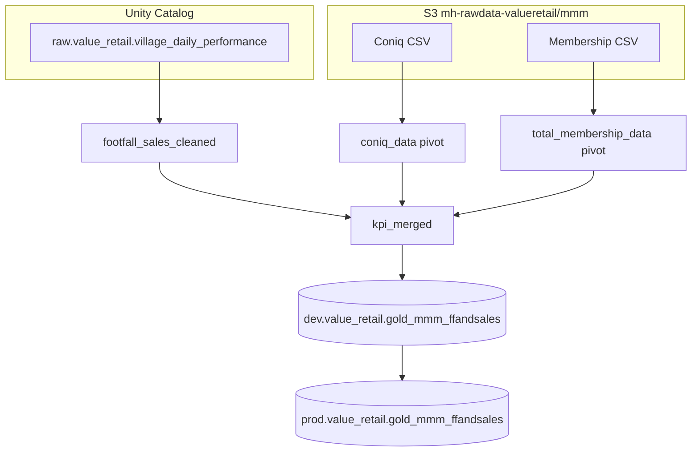

# FF and Sales Data Processing

{: .important }
> Notebook: [FF and Sales - Splits](https://dbc-341b6afb-df67.cloud.databricks.com/editor/notebooks/1008854611844160?o=7058903129942627)  
> Path: `/Users/anas.ahmed@mediahubww.com/FF and Sales - Splits`  
> Object ID: `1008854611844160`

This notebook builds the **weekly footfall & sales KPI gold table** for Value Retail MMM. It combines village daily performance (sales / footfall) with Coniq and Membership data split Domestic vs International, then derives non-member sales and footfall splits used downstream (including by [Non-Media Data Processing](non-media-data-processing) as the join spine).

---

## What it achieves

1. **Ingest** Coniq and Membership CSVs from S3; clean commas, cast types, map village codes, classify Domestic / International.
2. **Aggregate** daily village performance from ADLS / Unity Catalog into Monday week commencing KPIs.
3. **Merge** performance ⟕ Coniq ⟕ Membership into a weekly `kpi_merged` view.
4. **Derive** member vs non-member sales and footfall, plus Coniq-share–based Domestic / International splits (including ATV-adjusted footfall).
5. **Persist** to `dev.value_retail.gold_mmm_ffandsales`, then promote overwrite to `prod.value_retail.gold_mmm_ffandsales`.
6. **Coniq**
7. **Membership** 

{: .note }
> Week grain is **week commencing Monday**. Coniq applies a **+7 day** offset for 2026 weeks; Membership applies **+7 days** for 2025 and 2026.

---

## Pipeline overview



---

## Shared helpers

| Helper | Role |
|---|---|
| `village_mapping` | Village code → full name (BV → Bicester Village, …) |
| `village_domestic` + `map_country_village` | Country vs village home market → Domestic / International / Ignore |
| `week_commencing_udf` | ISO week number + year → Monday date string (`%G %V %u`) |

Ignore geographies: `<No Geography>`, empty, `null`, `<Geography Find Error>`.

---

## Data sources

### 1. Coniq

| | |
|---|---|
| **Path** | `s3a://mh-rawdata-valueretail/mmm/coniq/Coniq_data_2025 + 2026 Q1.csv` |
| **Grain after transform** | Week commencing × village × Domestic/International |
| **Temp view** | `coniq_data` |

**Metrics pivoted** (prefixed `Coniq_`): Tracked Transactions, Tracked Sales Net, Tracked ATV.

**Processing:** Strip thousand separators; cast types; map village code → name; classify Domestic / International from Country; extract week number from `Week`; derive Monday; for **Week Year = 2026** add 7 days; pivot on `cross_section`.

**Adds to final dataset:** Domestic / International Coniq tracked sales, ATV, and transactions — used to compute Coniq shares that split non-member sales and footfall.

---

### 2. Membership (Total Members)

| | |
|---|---|
| **Path (active)** | `s3a://mh-rawdata-valueretail/mmm/Membership/Membership Total Members (2023 - 2026 Q1) - Updated (1).csv` |
| **Earlier file in notebook** | `Membership Total Members (2023 - 2025) - Updated.csv` (overwritten by the 2026 Q1 load) |
| **Grain** | Week commencing × village × Domestic/International |
| **Temp view** | `total_membership_data` |

**Metrics pivoted** (prefixed `Member_`): Tracked Transactions, Total Members, Tracked Village Footfall, Tracked Sales Net, Tracked ATV, Tracked Village Spend per Visit.

**Processing:** Same clean / Domestic-International / week logic as Coniq; for **Week Year in (2025, 2026)** add 7 days to Monday; pivot on `cross_section`.

**Adds to final dataset:** Domestic and international member counts, tracked sales, ATV, and member footfall — the member side of the gold KPI split.

{: .warning }
> The notebook comments that membership transforms have historically looked wrong even when the CSV reads correctly — validate Domestic/International pivots after refresh.

---

### 3. Village daily performance (FF & Sales spine)

| | |
|---|---|
| **Table** | `raw.value_retail.village_daily_performance` |
| **Temp view** | `footfall_sales_cleaned` |
| **Role** | Primary weekly sales / footfall spine |

**Processing (SQL):**

- Exclude `village_code = 'SH'`, and villages `Suzhou Village`, `Belmont Park Village`
- Truncate `date` to week start Monday
- Special-case week **53** for `2024-12-30`
- Aggregate: `SUM(sales)` → `total_sales`, `SUM(village_footfall)` → `total_village_footfall`, `SUM(atv)` → `atv`

**Adds to final dataset:** Total village sales and footfall by week — denominator for non-member residual calculations.

---

## How sources combine

### Step A — `kpi_merged`

Left-join on year + week commencing Monday + village name:

`footfall_sales_cleaned` ⟕ `coniq_data` ⟕ `total_membership_data`

Filter: `year > 2022`, drop NaN sales / footfall / ATV.

Merged fields include totals plus Domestic/International Member_* and Coniq_* measures (members, footfall, sales net, ATV, transactions).

### Step B — Gold aggregations & derived splits

From `kpi_merged`, the notebook creates `dev.value_retail.gold_mmm_ffandsales` with:

| Derived field | Logic (summary) |
|---|---|
| `total_members` | Domestic + international member totals |
| `total_member_sales` | Dom + int member tracked sales net |
| `total_non_member_sales` | Abs(total sales − total member sales) |
| `domestic_coniq_perc` / `international_coniq_perc` | Share of Coniq tracked sales net |
| `domestic_atv` / `international_atv` | Coniq sales ÷ Coniq transactions |
| `non_member_domestic_sales` / `…_international_sales` | Non-member sales × Coniq % |
| `sales_per_atv_*` | Non-member domestic/intl sales ÷ ATV |
| `adj_domestic_coniq_share` / `adj_international_coniq_share` | Shares renormalised via sales-per-ATV |
| `member_total_ff` | Dom + int member tracked village footfall |
| `non_member_total_ff` | Total village FF − member FF |
| `non_member_domestic_ff` / `…_international_ff` | Non-member FF × Coniq % |
| `adj_non_member_domestic_ff` / `adj_non_member_international_ff` | Non-member FF × adjusted Coniq shares |

{: .tip }
> The adjusted non-member footfall fields are the ones consumed as Domestic / International non-member FF in the non-media join spine (`prod.value_retail.gold_mmm_ffandsales`).

### Step C — Promote to prod

```text
DROP TABLE IF EXISTS prod.value_retail.gold_mmm_ffandsales
→ overwrite Delta from the latest gold select into prod.value_retail.gold_mmm_ffandsales
```

---

## Output artefacts

| Artefact | Detail |
|---|---|
| **Dev table** | `dev.value_retail.gold_mmm_ffandsales` (created via `CREATE TABLE AS`) |
| **Prod table** | `prod.value_retail.gold_mmm_ffandsales` (Delta overwrite, `overwriteSchema`) |
| **Grain** | `_year` × `week_commencing_monday` × `village_name` |
| **Downstream** | Spine for [Non-Media Data Processing](non-media-data-processing); SQL pulls / MMM exports |

---

## Operational notes

{: .warning }
> Membership and Coniq rely on exact S3 filenames (spaces and version suffixes). Refreshing Q1/FY data usually means updating the `FILE` / `FILE_MEMBER` constants.

{: .note }
> Belmont Park and Suzhou are excluded from the daily-performance aggregation. If BP is needed in gold FF/Sales, the `WHERE` filter in `footfall_sales_cleaned` must change.

{: .important }
> Week offsets differ by source and year (Coniq: +7 for 2026 only; Membership: +7 for 2025–2026). Misaligned offsets will break the year/week/village join into `kpi_merged`.
