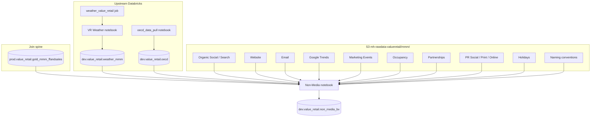

# Non-Media Data Processing

{: .important }
> Notebook: [Non-Media Data Processing](https://dbc-341b6afb-df67.cloud.databricks.com/editor/notebooks/146693345242482?o=7058903129942627)  
> Path: `/Users/anas.ahmed@mediahubww.com/Non-Media Data Processing`  
> Object ID: `146693345242482`

Builds the **weekly non-media feature set** for Value Retail MMM: clean each source to Monday week-commencing, pivot wide, left-join onto the FF & Sales spine, then split by village (BV written to `dev.value_retail.non_media_bv`).

---

## Source map

Where each non-media input comes from before it lands in the join:

| Origin | Sources | Refresh style |
|---|---|---|
| S3 CSVs | Organic, Website, Email, Trends, Events, Occupancy, Partnerships, PR, Holidays, Naming | Manual file drop / filename update in notebook |
| Scheduled job | [Weather](weather) | Weekly `weather_value_retail` |
| On-demand notebook | [OECD CCI/CPI](oecd) | Manual run of Shared OECD pull |
| Gold table | FF & Sales spine (see [Join & outputs](join-and-outputs)) | From [FF and Sales](../ff-and-sales-data-processing) pipeline |

---

## Pages in this section

| Page | Covers |
|---|---|
| [Organic & owned digital](organic-and-owned-digital) | Organic Social, Organic Search, Website |
| [Email](email) | CRM sends / opens by campaign group |
| [Google Trends & marketing events](google-trends-and-events) | Search interest + event flags |
| [Occupancy & partnerships](occupancy-and-partnerships) | Unit occupancy; partner sales & redemptions |
| [PR](pr) | Earned Social / Print / Online (MIV, reach) |
| [Holidays](holidays) | Holiday calendar covariates |
| [Weather](weather) | Open-Meteo job → `weather_mmm` |
| [OECD](oecd) | CCI & CPI → `oecd` |
| [Join & outputs](join-and-outputs) | Spine join order, village splits, `non_media_bv` |

{: .note }
> Other village frames (FV, IV, BP, KV, LR, LV, LZ) are built and displayed in the notebook. Only **BV** is written to Delta today. MV and WV sections are commented out.
