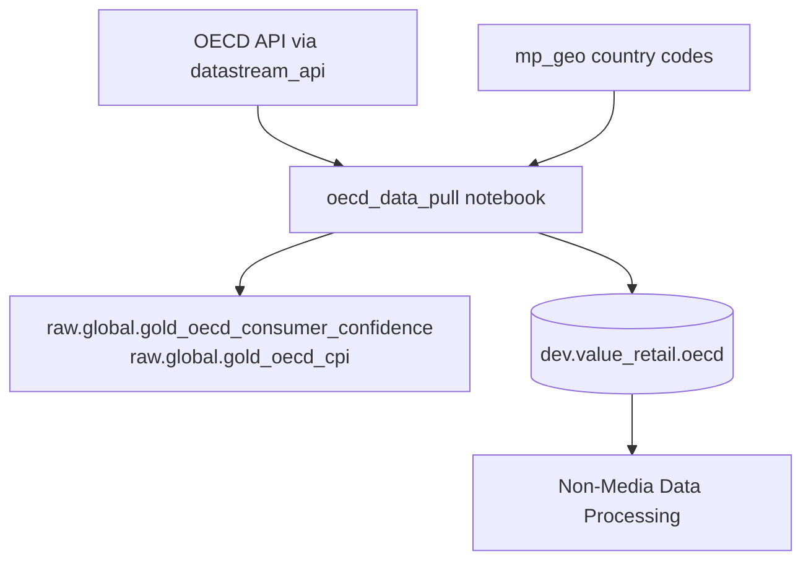

# OECD — CCI & CPI

OECD **Consumer Confidence Index (CCI)** and **Consumer Price Index (CPI)** are pulled manually (not scheduled), shaped to village-week variables, written to `dev.value_retail.oecd`, then left-joined in Non-Media.

## Upstream notebook

| | |
|---|---|
| **Notebook** | [(Clone) oecd_data_pull - Anas Rework Daily](https://dbc-341b6afb-df67.cloud.databricks.com/editor/notebooks/1325691730127916?o=7058903129942627) |
| **Path** | `/Shared/OECD ETL/(Clone) oecd_data_pull - Anas Rework Daily` |
| **Object ID** | `1325691730127916` |
| **Schedule** | **None** — run on demand when CCI/CPI need refreshing |
| **API helper** | `/Workspace/Repos/PROD/datastream-api/datastream_api/oecd` (`api_oecd.Actions`, `DICT_URLS`) |
| **Geo lookup** | `hive_metastore._global.mp_geo` (join on `country_code_3l`) |
| **Output table** | `dev.value_retail.oecd` (Delta overwrite) |

## What the notebook does

1. **Pull OECD series** for `consumer_confidence` and `cpi` via `Actions.get_data()` / `DICT_URLS`.
2. **Join country names** from `mp_geo` on 3-letter country code.
3. **Explode** each observation’s `start_date`→`end_date` into a daily `date` sequence, then map to **week commencing Monday**.
4. **Filter markets** relevant to Value Retail villages:
   - CCI: United States, Canada, Italy, Spain, United Kingdom, Belgium, France, Germany, Ireland
   - CPI: same set except Canada omitted in the CPI filter cell
5. **Map country → village code** and build variable names `{village}_{data_type}` (e.g. `BV_consumer_confidence`, `BV_cpi`):

| Country | Village code used |
|---|---|
| United Kingdom | BV |
| Italy | FV |
| Spain | LR |
| Ireland | KV |
| France | LV |
| Belgium | MV |
| Germany | WV *(dict key overwrites IV; Germany ends as WV in this notebook)* |
| United States | BP |

6. **Pivot** CCI and CPI separately to wide week × variable (avg value), then **left-join** CCI ⟕ CPI on `week_commencing_monday`.
7. **Overwrite** `dev.value_retail.oecd`. Intermediate long tables also land under `raw.global.gold_oecd_consumer_confidence` / `raw.global.gold_oecd_cpi`.

{: .note }
> Re-run the Shared OECD notebook when macro inputs need updating, then re-run Non-Media so village extracts pick up the new weeks.

## How Non-Media uses it

| | |
|---|---|
| **Read** | `spark.table("dev.value_retail.oecd")` |
| **Join** | `ff.Week_Commencing_Monday` = `oecd.week_commencing_monday` |

**Adds to final dataset:** Weekly CCI and CPI covariates by village/market — economic controls for the MMM.
