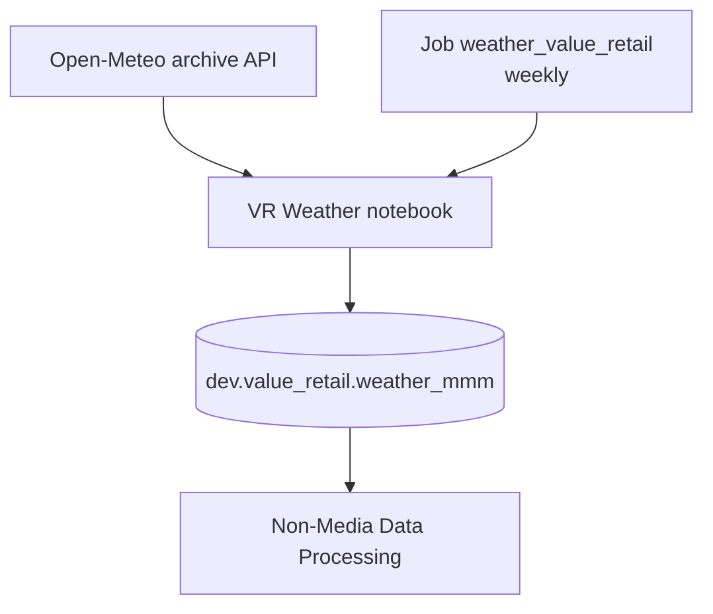

# Weather

Weather is **not** an S3 CSV. It is built upstream by a scheduled Databricks job, written to `dev.value_retail.weather_mmm`, then pivoted and left-joined in Non-Media.

## Upstream workflow

| | |
|---|---|
| **Job** | [weather_value_retail](https://dbc-341b6afb-df67.cloud.databricks.com/jobs/201837387433179?o=7058903129942627) (`201837387433179`) |
| **Task** | `VR_Weather` |
| **Notebook** | `/Users/anas.ahmed@mediahubww.com/MMM - Data Processing/VR Weather` |
| **Schedule** | Weekly (`interval: 1 WEEK`, currently **UNPAUSED**) |
| **On failure** | Email `anas.ahmed@mediahubww.com` |
| **Output table** | `dev.value_retail.weather_mmm` (Delta overwrite) |

## What the VR Weather notebook does

1. **Village coordinates** — lat/long for Bicester, Fidenza, Ingolstadt, Kildare, La Roca, La Vallée, Las Rozas, Maasmechelen, Wertheim, Belmont Park (Shanghai / Suzhou commented out).
2. **Pull daily history** from `https://archive-api.open-meteo.com/v1/archive` from `2020-01-01` through today (UTC), for each village:
   - `shortwave_radiation_sum`
   - `temperature_2m_mean` → stored as `temperature_mean`
   - `precipitation_sum`
   - `windspeed_10m_mean` → stored as `wind_speed`
3. **Week commencing Monday** — derive `week_starting_monday` from each daily `date`.
4. **Aggregate to week × village** — mean radiation, mean temperature, **sum** precipitation, mean wind speed; rename week column to `date`.
5. **Overwrite** `dev.value_retail.weather_mmm`.

| Output column | Grain / meaning |
|---|---|
| `date` | Week commencing Monday |
| `village` | Full village name |
| `shortwave_radiation` | Weekly mean of daily shortwave radiation |
| `temperature` | Weekly mean temperature (°C) |
| `precipitation` | Weekly sum of daily precipitation |
| `wind_speed` | Weekly mean wind speed |

## How Non-Media uses it

| | |
|---|---|
| **Read** | `spark.table("dev.value_retail.weather_mmm")` |
| **Transform** | Pivot villages wide on `date` |
| **Join** | `ff.Week_Commencing_Monday` = `weather.date` |

**Adds to final dataset:** Per-village weekly weather covariates (temperature, precipitation, radiation, wind).

{: .tip }
> If weather columns look stale in `non_media_bv`, check the latest run of [weather_value_retail](https://dbc-341b6afb-df67.cloud.databricks.com/jobs/201837387433179?o=7058903129942627) before re-running Non-Media.
