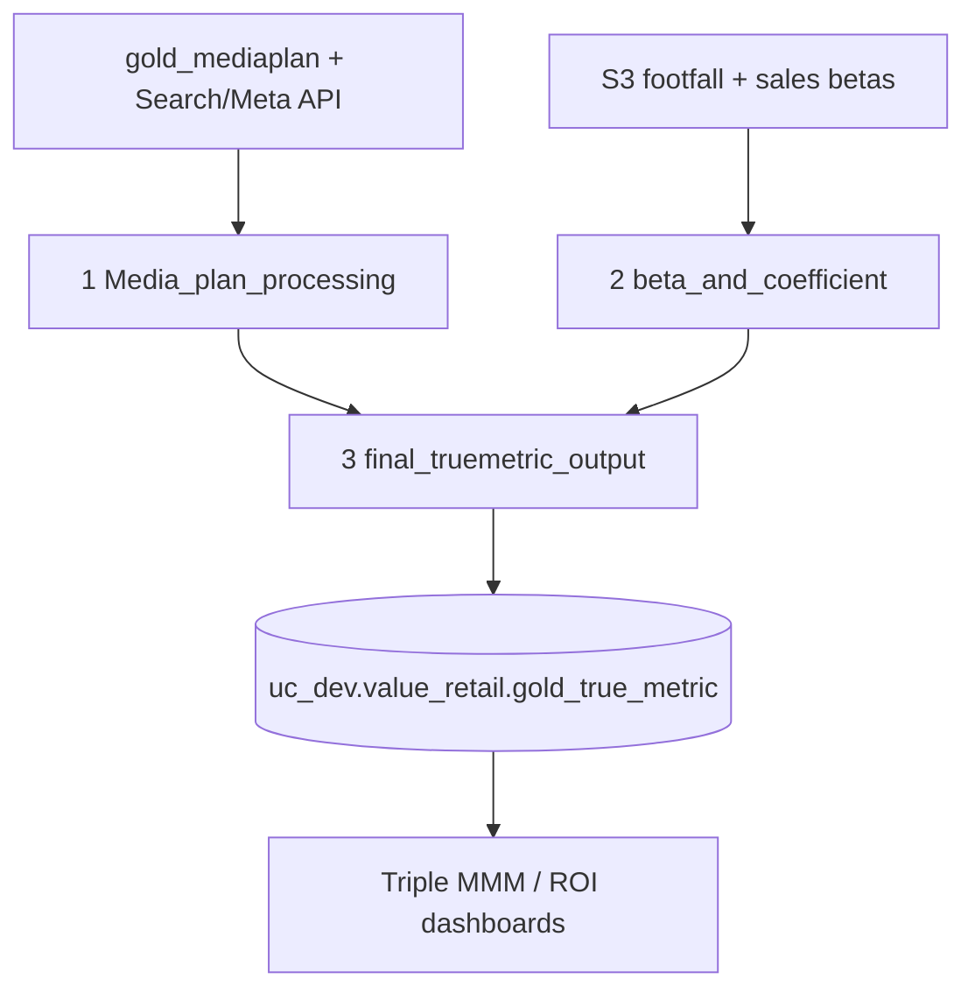

# True Metrics

Productionised application of the Value Retail MMM: take **live weekly spend**, attach model coefficients (α, β, λ), and output **weekly attributed footfall and sales** by channel × village.

> **In one line:** MMM tells us *how* media works. True Metrics tells us *how much it worked last week.*

{: .important }
> Job: [true_metrics_value_retail](https://dbc-341b6afb-df67.cloud.databricks.com/jobs/867177609529581?o=7058903129942627) (`867177609529581`)  
> Schedule: **Mondays 14:37 Europe/London** (`41 37 14 ? * Mon`), **UNPAUSED**  
> Cluster: `0908-154440-758js3qc`  
> Notebooks: `/Repos/DEV/datastream-etl/etl/value_retail/job/TrueMetricReport/`  
> Creator / run-as: `anas.ahmed@mediahubww.com`

**Coverage:** 9 villages (BV, LV, LR, LZ, IV, WV, FV, MV, KV) · weekly grain · 2025 onwards.

---

## Upstream → downstream

| Task key | Notebook | Output |
|---|---|---|
| `Media_plan_processing` | [Step 1 — Media spends](step-1-media-spends) | `uc_dev.value_retail.gold_mediaplan_true_metric` |
| `beta_and_coefficient` | [Step 2 — Betas](step-2-betas) | `uc_dev.value_retail.vr_true_metrics` |
| `final_truemetric_output` | [Step 3 — Attribution](step-3-attribution) | `uc_dev.value_retail.gold_true_metric` |

Depends-on chain: **1 → 2 → 3** (strict sequence). Max concurrent runs: 1.

{: .note }
> A fourth notebook `4 - Daily Spend Ratio Test View` exists in the same workspace folder but is **not** on this job. Related media spend standardisation for MMM modelling inputs is documented under [Media Investment Data](../mmm-data-processing/media-investment-data/).

---

## Coefficient vocabulary

| Symbol | Role |
|---|---|
| **λ (lambda / adstock)** | Decay rate — `adstock(t) = spend(t) + λ × adstock(t-1)` |
| **α (alpha)** | Saturation curve shape |
| **β (beta)** | Scaling coefficient — `contribution = response × β` |
| **MD / MI** | Media Domestic / Media International (attributed) |
| **NMD / NMI** | Non-media Domestic / International (baseline) |

---

## Pages in this section

| Page | What it covers |
|---|---|
| [Step 1 — Media spends](step-1-media-spends) | Standardise plan + API spend to MMM variables |
| [Step 2 — Betas](step-2-betas) | Load / pivot α β λ by audience; direct vs indirect |
| [Step 3 — Attribution](step-3-attribution) | Adstock → response → footfall + direct/indirect sales |
