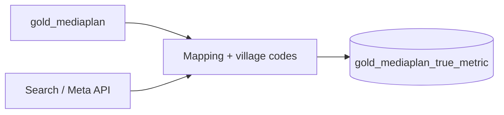

# Step 1 — Media spends

**Job task:** `Media_plan_processing`  
**Notebook:** `/Repos/DEV/datastream-etl/etl/value_retail/job/TrueMetricReport/1 -  Media Spends (Gold_Mediaplan) Process`

Builds the True Metrics spend spine: weekly media spend by channel, village, and audience, with names standardised to MMM media variables.

---

## Output

| Field | Role |
|---|---|
| Table | `uc_dev.value_retail.gold_mediaplan_true_metric` |
| Grain | daily x weekly × village × media variable × source |
| Key measures | Spend (EUR/GBP), impressions, clicks |
| `source` flag | `'mp'` (media plan) or `'API'` (Search / Meta delivery) |

---

## Sources

| Source | Table / path |
|---|---|
| Media plan | `uc_dev.value_retail.gold_mediaplan` (deep-cloned from `hive_metastore.value_retail.gold_mediaplan`) |
| Search API | `value_retail.gold_search_signaloutput` + `gold_parsed_searchcampaign` (Google Ads / PMax) |
| Social API | `value_retail.gold_social_signaloutput` + `gold_parsed_social` (Meta) |
| Validation join | `uc_dev.value_retail.vr_true_metrics` (cells 13–15 — which variables match coefficients) |

---

## What the notebook does

1. **Deep clone** Hive `gold_mediaplan` into UC `uc_dev.value_retail.gold_mediaplan`.
2. Build a **~150-row mapping table** from raw concatenated plan names (e.g. `DISPLAY_DISPLAY_Trade Desk_DOMESTIC`) to MMM variables (e.g. `Display_Domestic_spend`).
3. Map village names → codes (BV, LV, FV, MV, IV, KV, LR, LZ, WV; also BPV where present).
4. Categorise **Search** (Brand / Generic / VNT) and **Meta** (HVA vs NonHVA).
5. Overlay Search and Meta API delivery; keep plan vs API via `source`.
6. Apply filters (e.g. drop `theTradeDesk` from 30 May 2024 onwards to avoid CM360 double-count; earlier Skaze TTD kept).
7. Write `gold_mediaplan_true_metric` for Steps 2–3.

---

## Audience types

| Audience | Meaning |
|---|---|
| **DOMESTIC** | UK residents visiting UK villages |
| **DESTINATION** | International visitors to UK villages |

Example standardised names: `Display_Domestic_spend`, `Search_Brand_Domestic_spend`, `Meta_Domestic_HVA_spend`, `Performance_Max_Destination_spend`.

{: .note }
> Spend rows without a matching coefficient are still retained so dashboards can show full investment; attribution columns stay null until betas exist (see Step 3).

---

## Related

- Downstream: [Step 2 — Betas](step-2-betas) · [Step 3 — Attribution](step-3-attribution)
- Upstream media for modelling: [Media Investment Data](../mmm-data-processing/media-investment-data/)
