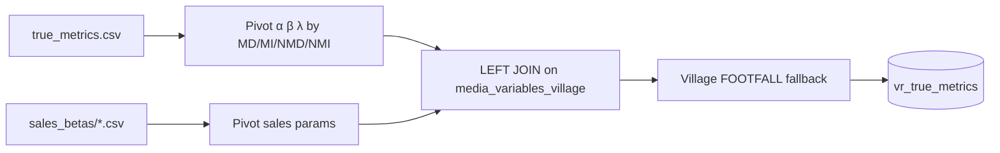

# Step 2 — Betas

**Job task:** `beta_and_coefficient`  
**Notebook:** `/Repos/DEV/datastream-etl/etl/value_retail/job/TrueMetricReport/2 - Betas and Co-efficient`

Loads footfall and sales MMM parameters from S3, pivots by audience (MD / MI / NMD / NMI), and writes a unified coefficient table for attribution.

---

## Output

| Field | Role |
|---|---|
| Table | `uc_dev.value_retail.vr_true_metrics` |
| Grain | media variable × village (`media_variables_village`, e.g. `SEARCH_BRAND_DOMESTIC_SPEND_BV`) |
| Footfall params | `MD_*` / `MI_*` / `NMD_*` / `NMI_*` × (`Alpha_a_init`, `Beta_Init`, `Adstock_Init`) |
| Sales params | Same audience split for **direct-effect** channels only (`*_sales_beta_init`, `*_sales_Alpha_A_Init`, `*_sales_Adstock_Init`) |

Write: Delta `overwrite` + `overwriteSchema`.

---

## Sources

| Source | Path |
|---|---|
| Footfall betas | `s3://mh-rawdata-valueretail/mmm/true_metric_betas/true_metrics.csv` |
| Sales betas | `s3://mh-rawdata-valueretail/mmm/sales_betas/*.csv` |
| Reference (display only) | `prod.value_retail.gold_mmm_ffandsales` |

S3 console (eu-west-1): [mh-rawdata-valueretail/mmm/](https://eu-west-1.console.aws.amazon.com/s3/buckets/mh-rawdata-valueretail?prefix=mmm/&region=eu-west-1)

{: .important }
> Refresh these files **after MMM retraining**, when adding channels, or when adjusting response curves — not on every Monday spend run.

---

## What the notebook does

1. Load `true_metrics.csv`; keep `status = 'Y'`; pivot α / β / λ by audience.
2. Build join key `media_variables_village` = media variable + village code.
3. Load sales betas (active MEDIA / FOOTFALL); pivot by hierarchy MD/MI/NMD/NMI.
4. **LEFT JOIN** footfall ↔ sales on that key:
   - Match → **direct-effect** channel (footfall + direct sales params)
   - No sales match → **indirect-only** (sales come via footfall in Step 3)
5. **Fallback:** where sales betas are null, fill from village-level FOOTFALL rows — DOMESTIC → MD/NMD, DESTINATION → MI/NMI.
6. Write `vr_true_metrics`.

---

## Coefficient roles

| Symbol | Meaning in this pipeline |
|---|---|
| **α** | Saturation curve shape |
| **β** | Scaling coefficient for contribution |
| **λ** | Adstock decay |
| **Direct-effect** | Channel has both footfall and sales betas |
| **Indirect-only** | Footfall only; sales attributed through footfall |

---

## Known follow-ups (from notebook TODOs)

- Make media-variable matching more dynamic / reusable
- Automate full footfall sheet ingest (today needs manual additions for new rows)
- Align audience segment buckets for adstock application

---

## Related

- Upstream spend: [Step 1 — Media spends](step-1-media-spends)
- Downstream attribution: [Step 3 — Attribution](step-3-attribution)
- Model inputs: [MMM Data Processing](../mmm-data-processing/) · [FF and Sales](../mmm-data-processing/non-media-data-processing/ff-and-sales-data-processing)
