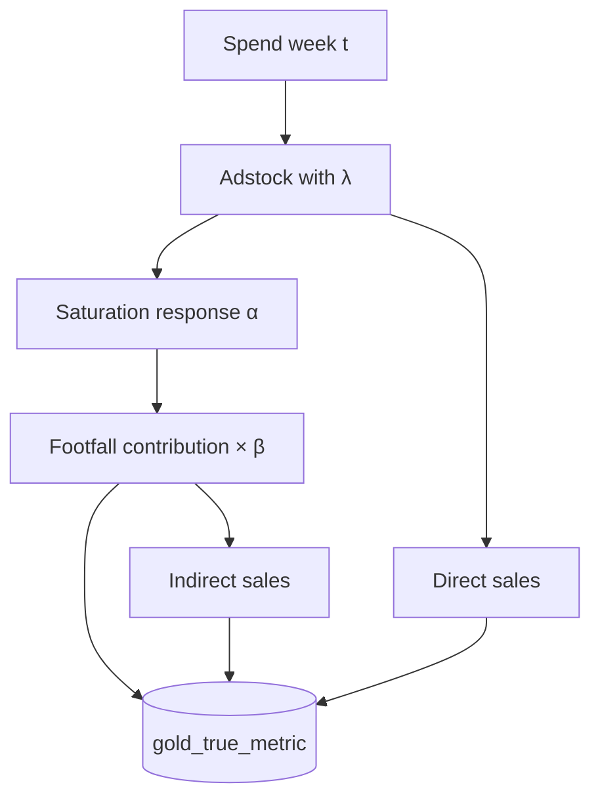

# Step 3 — Attribution

**Job task:** `final_truemetric_output`  
**Notebook:** `/Repos/DEV/datastream-etl/etl/value_retail/job/TrueMetricReport/3 - FF and Sales Calcs (Direct + In-direct)`

Applies adstock and saturation response to weekly spend, then attributes **footfall** and **direct / indirect sales** by channel × village × audience. Output feeds Triple MMM / ROI Power BI.

---

## Output

| Field | Role |
|---|---|
| Table | `uc_dev.value_retail.gold_true_metric` |
| Grain | week × village × media variable (audience / path as modelled) |
| Key measures | Adstocked media, response, attributed footfall, direct sales, indirect sales, spend |

---

## Inputs

| Input | Role |
|---|---|
| `uc_dev.value_retail.gold_mediaplan_true_metric` | Weekly spend / impressions ([Step 1](step-1-media-spends)) |
| `uc_dev.value_retail.vr_true_metrics` | α, β, λ by audience ([Step 2](step-2-betas)) |
| `raw.value_retail.village_daily_performance` | Actual / forecast village footfall & sales (indirect sales base); excludes Shanghai / Suzhou; drops `BPV` in merge filters |

---

## Methodology

### 1. Adstock

```
adstock(t) = spend(t) + λ × adstock(t-1)
```

### 2. Saturation response

```
response = (1 - e^(-α×adstock)) × (α×adstock) / (1 + α×adstock) 
```

### 3. Contribution

```
contribution = response × β
```

### 4. Direct vs indirect sales

- **Direct-effect channels** — sales params present: media drives sales directly (and footfall).
- **Indirect-only** — sales come from media → footfall → sales using village performance and sales/footfall betas.
- Helper logic in the betas notebook (threshold on sales β) can split direct vs indirect components when both paths apply.

### 5. Audience segments

| Code | Meaning |
|---|---|
| **MD** | Media Domestic |
| **MI** | Media International |
| **NMD** | Non-media Domestic (baseline) |
| **NMI** | Non-media International (baseline) |

Audience on the spend side is taken from the variable name (`DOMESTIC` / `DESTINATION`) when needed.



---

## What the notebook does

1. Join spend to coefficients on media variable × village (`media_variable_village`).
2. Keep **all spend** even when coefficients are missing (null adstock/β; spend still visible in dashboards).
3. Expand to a complete week × media-variable grid; fill static channel / audience / source attributes.
4. Run adstock → response → contribution by audience path.
5. Attribute direct and indirect sales; coalesce village actual vs forecast performance for totals.
6. Write `gold_true_metric` (Delta overwrite).

{: .note }
> Earlier filters dropped channel×village spend without coefficients. Current behaviour preserves spend so ROI views can show investment even when attribution is incomplete.

---

## Consumers

- Triple MMM / Value Retail Model Results PBIX (ROI, efficiency, scatters)
- Spot checks against [MMM Data Processing](../mmm-data-processing/) when a new beta set is loaded

---

## Related

- [True Metrics overview](./) · [Step 1](step-1-media-spends) · [Step 2](step-2-betas)
